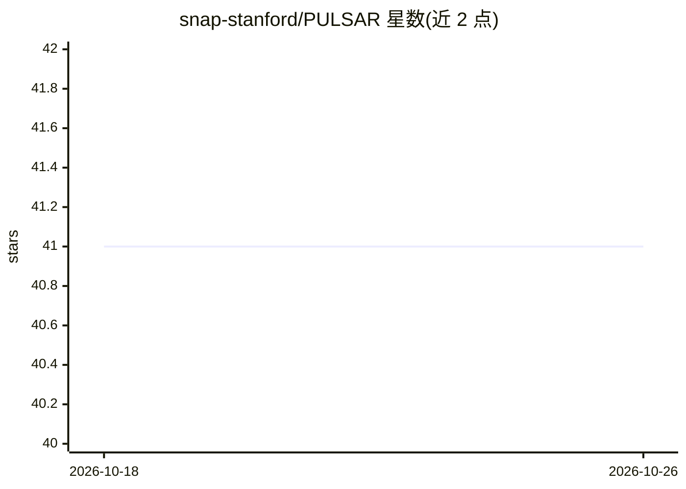

# snap-stanford/PULSAR

⭐ 41 · Python · MIT · 推送 2026-10-05 · [GitHub](https://github.com/snap-stanford/PULSAR) · 组织维护

**单细胞数据基础模型：从基因到细胞到供体多层整合建模**

面向人类外周免疫的 scRNA-seq 多尺度多细胞基础模型，在 6,807 名供体的 3,620 万个细胞上自监督预训练，连接单细胞数据与临床表型。提供 87.4M 参数的 PULSAR-pbmc 与疾病标签对齐的 PULSAR-aligned 两组权重，经 transformers 可直接加载；附带从 H5AD 提取供体嵌入的工具、零样本年龄回归/红斑狼疮疾病分类等示例 notebook，并发布 DONORxEMBED 供体嵌入数据集。安装依赖 uv 管理虚拟环境。

## 筛选速览

| 维度 | 判定 | 备注 |
|---|---|---|
| AI 角色 | `ai-native` | 本体是模型或模型工具 |
| 许可风险 | `permissive` | MIT |
| 部署形态 | `library` | 以包/库形式分发 |
| 模型依赖 | — | README 未给出锁定关系 |
| 硬件要求 | — | 无带数字的原话,不猜 |
| 安装摩擦 | `low` | 无编译、无系统依赖或容器化 |
| 成熟度 | — | 结构信号不足 |

## 能力要点

- 3,620 万细胞 / 6,807 供体自监督预训练
- 提供 87.4M 参数的 PULSAR-pbmc 与 PULSAR-aligned 两组权重（HuggingFace 下载）
- 从 H5AD 单细胞数据提取供体级嵌入的工具函数
- 发布 DONORxEMBED 数据集及零样本年龄回归、疾病分类示例

## 适用场景

- 用零样本供体嵌入做年龄回归或疾病分类
- 在 PBMC 相关任务上加载预训练模型提取供体嵌入
- 基于 DONORxEMBED 数据集做供体相似性检索

## 场景标签

 · 领域:计算生物学/单细胞基因组学

## 证据(README 行号)

> L3: PULSAR (Patient Understanding Leveraging Single-cell universAl Representation) is a multi-scale, multicellular found
> L20: model = PULSAR.from_pretrained("KuanP/PULSAR-pbmc")

## 星数曲线

2026-10-18 41 → 2026-10-26 41（+0）

---
*卡片 v1 · prompt 1.4 · 生成 2026-10-25 · 置信度 mid · 依据 README sha `b79551b24a47` · [字段定义](../../DATASET.md)*
