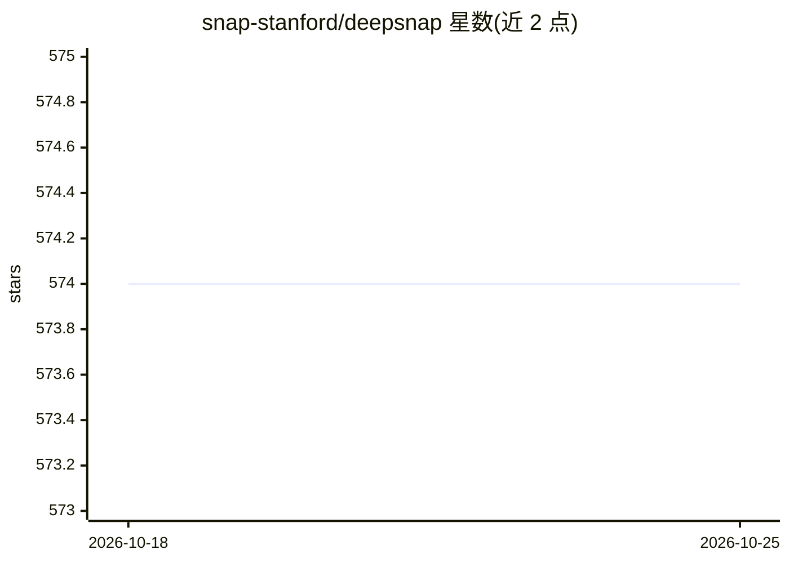

# snap-stanford/deepsnap

⭐ 574 · Python · MIT · 推送 2025-11-24 · [GitHub](https://github.com/snap-stanford/deepsnap) · [官网](https://snap.stanford.edu/deepsnap/) · 组织维护

**给 GNN 开发者：桥接 NetworkX 与 PyTorch Geometric 的图深度学习辅助库**

DeepSNAP 是一个协助图深度学习的 Python 库，定位在图操作库 NetworkX 与深度学习框架 PyTorch Geometric 之间：提供基于 NetworkX 的后端（同质无向图另支持 SnapX 后端），可在训练迭代中调用图算法进行操作与变换；内置数据集划分、负采样及节点/边/图级任务目标的标准流程；支持节点与边异质性的异质 GNN。以 pip 安装，需先安装 PyTorch Geometric 与 NetworkX，也可从源码构建；仓库附带节点分类、链接预测、图分类示例及 Colab 教程。由斯坦福 snap-stanford 维护。

## 筛选速览

| 维度 | 判定 | 备注 |
|---|---|---|
| AI 角色 | `ai-ecosystem` | LLM/agent 周边工具 |
| 许可风险 | `permissive` | MIT |
| 部署形态 | `library` | 以包/库形式分发 |
| 模型依赖 | — | README 未给出锁定关系 |
| 硬件要求 | — | 无带数字的原话,不猜 |
| 安装摩擦 | `low` | 无编译、无系统依赖或容器化 |
| 成熟度 | — | 结构信号不足 |

## 能力要点

- 基于 NetworkX 的后端（同质无向图另有 SnapX 后端），可在训练中调用图算法
- 标准流程：数据集划分、负采样、节点/边/图级任务目标定义
- 支持节点与边异质性的异质 GNN 消息传递控制
- 与 PyTorch Geometric 模型/数据集兼容的 API

## 适用场景

- 在 GNN 训练流程中灵活做图变换与算法调用
- 快速搭建节点分类、链接预测、图分类实验
- 基于 PyTorch Geometric 的现有项目扩展异质图支持

## 场景标签

 · 领域:图机器学习/深度学习

## 证据(README 行号)

> L12: DeepSNAP is a Python library to assist efficient deep learning on graphs.
> L15: DeepSNAP bridges powerful graph libraries such as NetworkX and deep learning framework PyTorch Geometric. With an i

## 星数曲线

2026-10-18 574 → 2026-10-25 574（+0）

---
*卡片 v1 · prompt 1.4 · 生成 2026-10-21 · 置信度 high · 依据 README sha `8b0773f1c7a0` · [字段定义](../../DATASET.md)*
