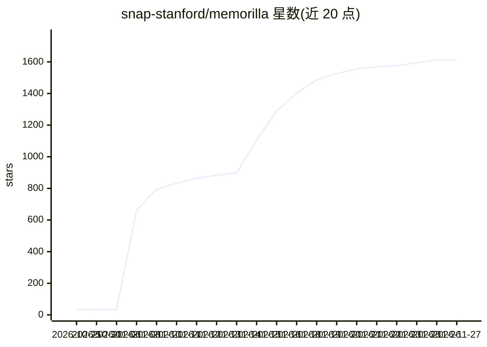

# snap-stanford/memorilla

⭐ 1,613 · Python · Apache-2.0 · 推送 2026-11-25 · [GitHub](https://github.com/snap-stanford/memorilla) · [官网](https://memory.stanford.edu) · 组织维护

**面向 LLM 的潜在语义记忆系统：把文档集合压缩为 16 个记忆 token**

提供训练与评估代码的研究项目：训练一个记忆模块，将整份文档集合编码为固定数量的查询相关记忆 token，供冻结 LLM 使用；官方支持 Qwen3-8B 解码器与 Qwen3-Embedding-4B 编码器，基于 vLLM 推理，提供记忆缓存、TextWorld 上的 GRPO 强化学习训练（SkyRL fork）与自定义 parquet 数据训练接口。需要 Linux + CUDA GPU，配方在 H100 80GB 上运行；另发布 PersonaMem-v2 与 PersonalizationV4 基准。Apache-2.0 许可。

## 筛选速览

| 维度 | 判定 | 备注 |
|---|---|---|
| AI 角色 | `ai-ecosystem` | LLM/agent 周边工具 |
| 许可风险 | `permissive` | Apache-2.0 |
| 部署形态 | `library` | 以包/库形式分发 |
| 模型依赖 | local-ok | 支持本地模型 |
| 硬件要求 | — | 无带数字的原话,不猜 |
| 安装摩擦 | `medium` | 含编译或系统依赖之一 |
| 成熟度 | — | 结构信号不足 |

## 能力要点

- 将整份文档集合压缩为 16 个查询相关记忆 token 输入冻结 LLM
- 提供记忆缓存：问题查询时只需对缓存的 cross-attention KV 做 attention
- 支持 TextWorld 文本冒险上的 GRPO 强化学习（SkyRL-Memorilla fork）
- 支持自定义问答数据集训练，无需改代码

## 适用场景

- 让助手基于用户历史 107 段对话回答偏好类问题
- 长文档/书籍问答时压缩上下文降低推理延迟
- 训练 agent 从自身交互历史持续学习

## 场景标签

`RAG` `强化学习` `Agent 记忆` · 领域:Agent 开发

## 证据(README 行号)

> L14: This repository provides code for training and evaluating Memorilla, a memory system that gathers information from 
> L30: Memorilla needs Linux with CUDA GPUs and Python 3.11; the recipes were run on NVIDIA H100 80GB GPUs. Install it wit
> L191: Memorilla can also serve as the memory of an agent and learn from reward alone. `rl/` trains the

## 星数曲线

2026-10-25 34 → 2026-11-27 1,613（+1,579）

---
*卡片 v1 · prompt 1.4 · 生成 2026-11-23 · 置信度 high · 依据 README sha `bd2a25b98727` · [字段定义](../../DATASET.md)*
