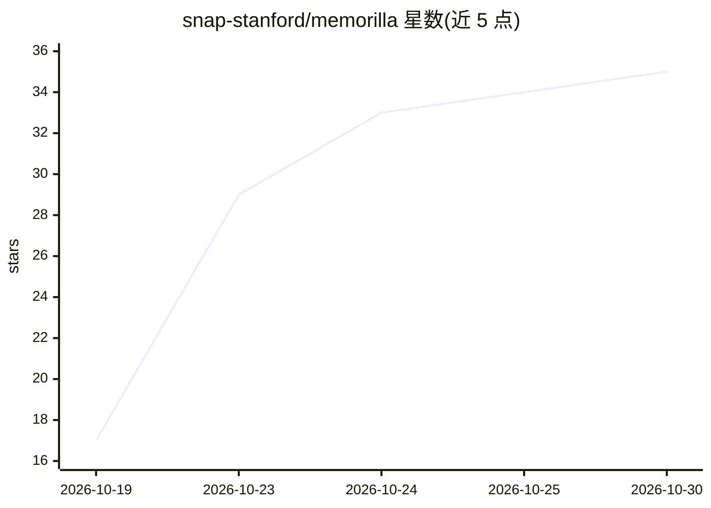

# snap-stanford/memorilla

⭐ 35 · Python · Apache-2.0 · 推送 2026-10-26 · [GitHub](https://github.com/snap-stanford/memorilla) · [官网](https://memory.stanford.edu) · 组织维护

**给冻结 LLM 的隐式语义记忆系统：文档集压缩为 16 个记忆 token**

基于同名论文的研究代码库：训练一个记忆模块，将整个文档集合（如用户历史对话、长书）压缩为固定数量（默认 16 个）的查询相关记忆 token，交给冻结的 LM（如 Qwen3-8B）使用，从而突破上下文窗口限制。支持三阶段训练、八个基准评测、自有数据训练、个性化基准 PersonalizationV4，以及在 TextWorld 上用 GRPO 做强化学习。需要 Linux + CUDA GPU（配方在 4×H100 80GB 上运行），通过 uv 从源码安装，检查点发布于 Hugging Face。

## 筛选速览

| 维度 | 判定 | 备注 |
|---|---|---|
| AI 角色 | `ai-ecosystem` | LLM/agent 周边工具 |
| 许可风险 | `permissive` | Apache-2.0 |
| 部署形态 | `library` | 以包/库形式分发 |
| 模型依赖 | local-ok | 支持本地模型 |
| 硬件要求 | — | 无带数字的原话,不猜 |
| 安装摩擦 | `medium` | 含编译或系统依赖之一 |
| 成熟度 | — | 结构信号不足 |

## 能力要点

- 将文档集压缩为 16 个查询相关记忆 token 供冻结 LLM 使用
- 提供三阶段训练配方与 8 个基准评测脚本
- 支持自有 parquet 数据无改码训练评估
- 记忆模块可在 TextWorld 上以 GRPO 强化学习训练

## 适用场景

- 让 LLM 利用远超上下文窗口的个人历史对话回答问题
- 压缩长文档（书、剧本）以低成本问答
- 为强化学习 agent 提供可训练记忆并从奖励中学习

## 场景标签

`Agent 记忆` · 领域:Agent 开发

## 证据(README 行号)

> L8: This repository provides code for training and evaluating Memorilla, a memory system that gathers information from a
> L9: entire document collection into a fixed number of query-dependent memory tokens for a frozen LLM. The code is based 
> L12: A frozen LLM can only use what fits in its context window, so Memorilla reads an entire document collection, such a

## 星数曲线

2026-10-19 17 → 2026-10-30 35（+18）

---
*卡片 v1 · prompt 1.4 · 生成 2026-10-25 · 置信度 high · 依据 README sha `b9324685fe08` · [字段定义](../../DATASET.md)*
