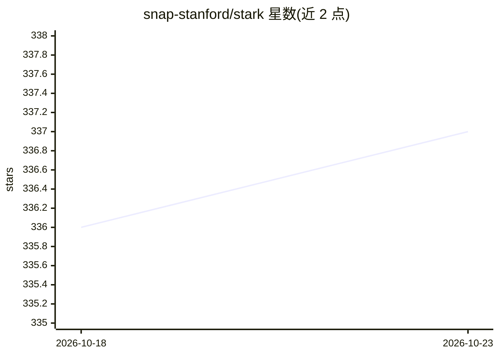

# snap-stanford/stark

⭐ 337 · Python · MIT · 推送 2026-02-06 · [GitHub](https://github.com/snap-stanford/stark) · [官网](https://stark.stanford.edu/) · 组织维护 · 中文 README

**评测 LLM 检索系统的半结构化知识库基准（NeurIPS 2024）**

Stanford snap 组维护的大规模半结构化检索基准：覆盖 Amazon 产品搜索、学术论文搜索（MAG）与生物医学（PrimeKG）三个知识库，提供问答对数据、官方数据切分与评测脚本，支持 BM25、Colbertv2、VSS、MultiVSS、LLMReranker 等检索模型评测，可用多种嵌入模型（ada-002、GritLM、LLM2Vec 等）生成查询/文档向量。以 pip 包 stark-qa 分发，数据自动从 Hugging Face 下载，也提供从原始数据预处理的代码。面向做检索系统与 RAG 评测的研究者。

## 筛选速览

| 维度 | 判定 | 备注 |
|---|---|---|
| AI 角色 | `ai-ecosystem` | LLM/agent 周边工具 |
| 许可风险 | `permissive` | MIT |
| 部署形态 | `library` | 以包/库形式分发 |
| 模型依赖 | — | README 未给出锁定关系 |
| 硬件要求 | — | 无带数字的原话,不猜 |
| 安装摩擦 | `low` | 无编译、无系统依赖或容器化 |
| 成熟度 | — | 结构信号不足 |

## 能力要点

- 三个半结构化知识库（Amazon/MAG/PrimeKG）的检索问答数据
- 内置 BM25/Colbertv2/VSS/MultiVSS/LLMReranker 评测脚本
- pip 包形式分发，数据自动从 Hugging Face 下载
- 提供预处理代码与人工生成查询评测集

## 适用场景

- 我要评测自己检索模型在半结构化知识库上的表现
- 为 RAG 系统选型做跨领域检索基准测试
- 获取带官方切分的大规模检索问答数据集

## 场景标签

`模型评测` `语义搜索` · 领域:评测与运维

## 证据(README 行号)

> L20: STaRK is a large-scale Semi-structured Retrieval Benchmark on Textual and Relational Knowledge bases, covering appl
> L86: - Run the python script for evaluation. E.g.,

## 星数曲线

2026-10-18 336 → 2026-10-23 337（+1）

---
*卡片 v1 · prompt 1.4 · 生成 2026-10-22 · 置信度 high · 依据 README sha `4a4ac663922e` · [字段定义](../../DATASET.md)*
