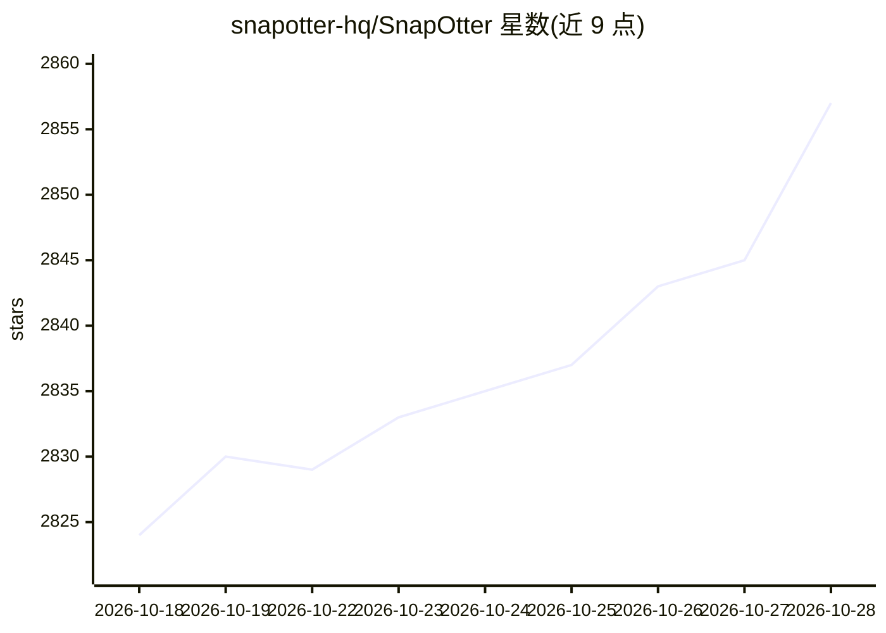

# snapotter-hq/SnapOtter

⭐ 2,857 · TypeScript · AGPL-3.0 · 推送 2026-10-27 · [GitHub](https://github.com/snapotter-hq/SnapOtter) · [官网](https://snapotter.com) · 个人维护

**自托管文件处理套件：转换/压缩/OCR/转录与本地 AI，文件不出网**

开源自托管的文件处理基础设施，覆盖图片、视频、音频、PDF 与文档五类共 200+ 工具：格式转换、压缩、OCR、音频转录、元数据剥离，以及本地 AI 功能（去背景、图像放大、老照片修复上色、人脸模糊、视频自动字幕等），通过 UI、REST API 与可编排的 Pipeline 使用。单容器 docker run 即可启动（内嵌 Postgres 17 + Redis 8），生产环境用 Compose 三容器部署，支持 AMD64/ARM64，可选 NVIDIA CUDA 加速，另支持 OIDC/SSO 登录与 21 种界面语言。文件处理全程在本机硬件完成。

## 筛选速览

| 维度 | 判定 | 备注 |
|---|---|---|
| AI 角色 | `ai-enhanced` | 去掉 AI 部分产品仍成立 |
| 许可风险 | `dual` | AGPL-3.0 |
| 部署形态 | `self-host` | docker 或自建部署 |
| 模型依赖 | — | README 未给出锁定关系 |
| 硬件要求 | — | 无带数字的原话,不猜 |
| 安装摩擦 | `low` | 无编译、无系统依赖或容器化 |
| 成熟度 | — | 结构信号不足 |

## 能力要点

- 200+ 工具覆盖图像/视频/音频/PDF/文件五类模态
- 本地 AI：去背景、放大、修复上色、OCR、音频转录、自动字幕，无需联网
- REST API 与最多 20 步的 Pipeline 工作流编排，支持批量处理
- 单容器 docker run 快速启动，支持 AMD64/ARM64 与可选 NVIDIA CUDA 加速

## 适用场景

- 在内网或自有服务器上完成格式转换、压缩、OCR 与转录，文件不出网
- 把常用文件处理操作串成可复用的流水线批量执行
- 通过 REST API 把文件处理能力接入自己的应用

## 场景标签

`工作流自动化` `图像视频处理` `OCR` `语音识别` · 领域:效率与自动化

## 证据(README 行号)

> L14:  Open-source, self-hosted file-processing infrastructure. Convert, compress, OCR, transcribe, strip metadata, and r
> L43: - **Local AI:** Remove backgrounds, upscale images, restore and colorize old photos, erase objects, blur faces, enh

## 星数曲线

2026-10-18 2,824 → 2026-10-28 2,857（+33）

---
*卡片 v1 · prompt 1.4 · 生成 2026-10-21 · 置信度 high · 依据 README sha `b60e19a3be6d` · [字段定义](../../DATASET.md)*
