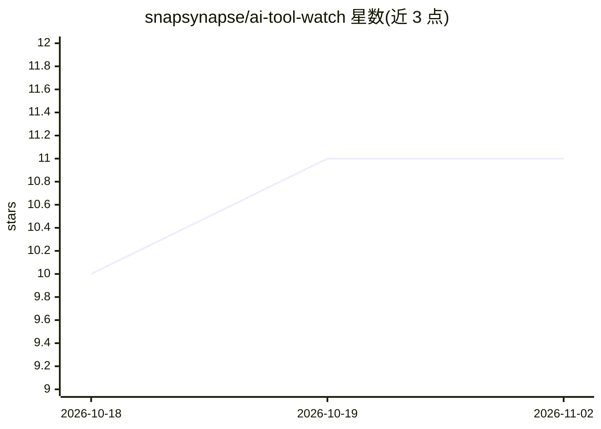

# snapsynapse/ai-tool-watch

⭐ 11 · JavaScript · MIT · 推送 2026-10-30 · [GitHub](https://github.com/snapsynapse/ai-tool-watch) · [官网](https://aitool.watch) · 组织维护

**面向人和 agent 的 AI 工具能力/价格/可用性参考库**

以 markdown/YAML 文件维护的 AI 工具参考数据：覆盖 8 个厂商的 18 项能力与 87 个实现，记录订阅档位解锁情况、平台支持、价格与约束。零依赖 Node.js 构建脚本生成静态站点、10 个 JSON API 文件及 125 个桥接页，并提供 15 个只读工具的 MCP server 供 agent 查询。数据通过四模型级联核验加人工审查保持更新，7 天内未复验的特性被标记。自托管运行时与开源模型记录已归档冻结，不再刷新。面向 AI 教学 facilitator、教育者、开发者和 agent 使用。

## 筛选速览

| 维度 | 判定 | 备注 |
|---|---|---|
| AI 角色 | `ai-knowledge` | 知识聚合/清单类 |
| 许可风险 | `permissive` | MIT |
| 部署形态 | `None` |  |
| 模型依赖 | — | README 未给出锁定关系 |
| 硬件要求 | — | 无带数字的原话,不猜 |
| 安装摩擦 | `low` | 无编译、无系统依赖或容器化 |
| 成熟度 | — | 结构信号不足 |

## 能力要点

- markdown+YAML 数据源，零依赖 Node 脚本生成站点/JSON API/MCP
- MCP server 提供 15 个只读工具，兼容新旧两版 MCP 规范
- 四模型级联核验+人工审查门的数据更新流程
- 18 项能力、87 个实现、125 个桥接页、WCAG 2.1 AA 无障碍

## 适用场景

- 在选 AI 订阅档位前查某能力是否可用
- 让 agent 通过 MCP 或 JSON API 查询工具能力事实
- 对比不同 AI 产品的平台支持与价格约束

## 场景标签

`精选清单` · 领域:学习与行业

## 证据(README 行号)

> L15: AI tool capabilities, plan limits, and constraints change constantly and are scattered across marketing pages. AI T
> L28: Built for AI facilitators, educators, developers, and AI agents that need accurate, current information about AI to
> L75: - **JSON API** — 10 stable files at `docs/api/v1/` covering all entity types and derived views (usage guide)

## 星数曲线

2026-10-18 10 → 2026-11-02 11（+1）

---
*卡片 v1 · prompt 1.4 · 生成 2026-11-01 · 置信度 high · 依据 README sha `dc68c5b525b1` · [字段定义](../../DATASET.md)*
