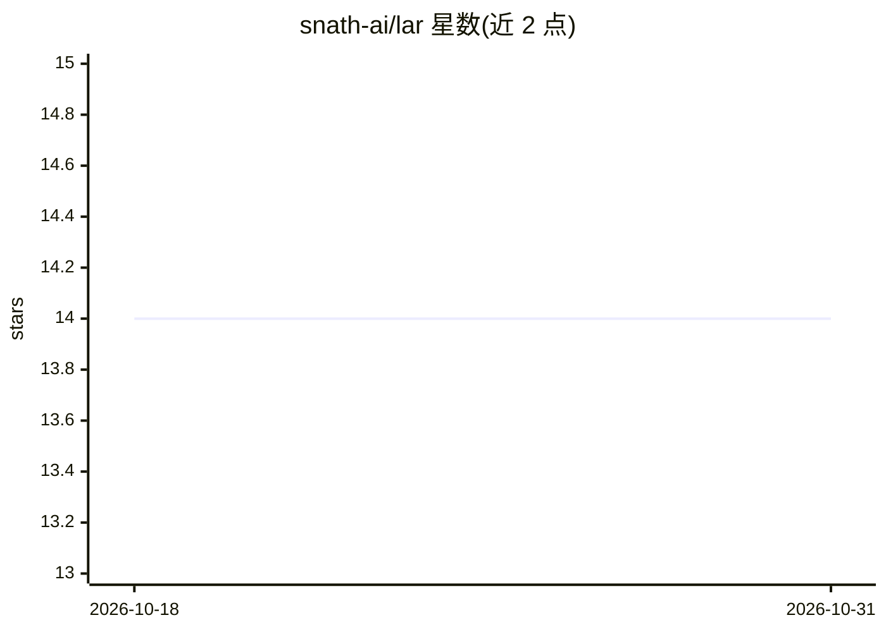

# snath-ai/lar

⭐ 14 · Python · Apache-2.0 · 推送 2026-10-20 · [GitHub](https://github.com/snath-ai/lar) · [官网](https://docs.snath.ai) · 组织维护

**面向 EU AI Act 取证的确定性 Agent 执行引擎**

Python 实现的独立 agent 执行引擎（非 LangChain 等库的封装），以确定性图执行、逐步状态 diff、HMAC-SHA256 签名审计轨迹为核心机制，提供 22 个映射到 EU AI Act 条款（Art. 12/14/50 等）的合规原语（HumanJuryNode、ProhibitedPracticeGuard、PIIRedactionEngine 等）。面向金融、医疗、法律等需向监管证明 agent 行为的团队。以 PyPI 包分发，Apache 2.0 开源，另有企业层（lar.enterprise 便捷封装）。默认对照模型为 ollama/phi4，可经 LAR_SHOWCASE_MODEL 覆盖。

## 筛选速览

| 维度 | 判定 | 备注 |
|---|---|---|
| AI 角色 | `ai-ecosystem` | LLM/agent 周边工具 |
| 许可风险 | `permissive` | Apache-2.0 |
| 部署形态 | `library` | 以包/库形式分发 |
| 模型依赖 | local-ok | 支持本地模型 |
| 硬件要求 | — | 无带数字的原话,不猜 |
| 安装摩擦 | `low` | 无编译、无系统依赖或容器化 |
| 成熟度 | — | 结构信号不足 |

## 能力要点

- 确定性图执行：每次 yield 输出状态前/后、diff、token 用量与提示词
- 22 个 EU AI Act 合规原语（人类监督、禁止行为拦截、PII 擦除、合成内容标记等）
- HMAC-SHA256 签名的逐步因果审计轨迹与完整性校验
- 提供金融信贷与贷款审批两个可运行合规示例脚本

## 适用场景

- 金融/医疗等受监管行业的 agent 开发中生成监管取证证据
- 需要在人类监督节点做自动化边界控制的审批类 agent 流程
- 对 agent 每步决策与 token 成本留痕以便调试和审计

## 场景标签

`Agent 框架` · 领域:Agent 开发

## 证据(README 行号)

> L24: Lár is a ground-up agent execution engine where **auditability is structural, not an add-on**. Every design decisio
> L35: |**Lár** ← you are here|The execution spine — deterministic graph engine, 22 EU AI Act compliance primitives, HMAC 
> L127: Lár runs **one node at a time**, yielding a structured audit entry after every step. The execution model is a Pyth

## 星数曲线

2026-10-18 14 → 2026-10-31 14（+0）

---
*卡片 v1 · prompt 1.4 · 生成 2026-10-31 · 置信度 high · 依据 README sha `62081e62c7cd` · [字段定义](../../DATASET.md)*
