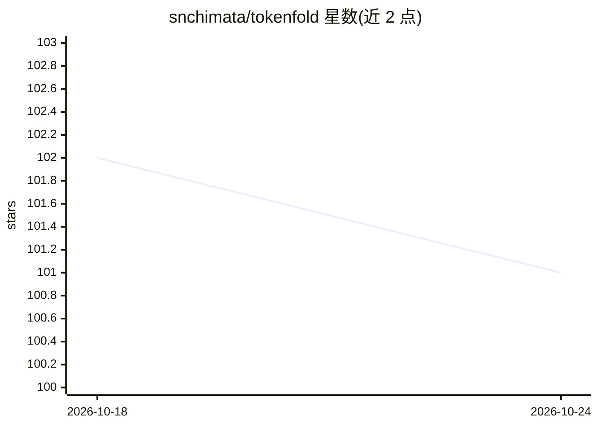

# snchimata/tokenfold

⭐ 101 · Rust · Apache-2.0 · 推送 2026-10-17 · [GitHub](https://github.com/snchimata/tokenfold) · 个人维护

**LLM 结构化 JSON 的确定性无损压缩工具与本地代理**

面向开发者与 AI 团队的 token 压缩工具：对结构化 JSON（工具定义、API 响应、RAG 数据）做无模型的列式折叠与最小化，无损模式可精确解码还原，压缩前经内存内往返验证；异构数组提供可选且可恢复的有损剪枝。提供 Python/npm/Rust 库、独立 CLI、stdio MCP 服务器，以及监听 127.0.0.1:8787 的 OpenAI 兼容本地代理，转发前压缩 chat 请求体，任意自定义 base URL 的客户端可直接接入。README 明确说明精确解码仅证明数据还原，不保证下游任务效果不变，需自行验证。

## 筛选速览

| 维度 | 判定 | 备注 |
|---|---|---|
| AI 角色 | `ai-ecosystem` | LLM/agent 周边工具 |
| 许可风险 | `permissive` | Apache-2.0 |
| 部署形态 | `library` | 以包/库形式分发 |
| 模型依赖 | — | README 未给出锁定关系 |
| 硬件要求 | — | 无带数字的原话,不猜 |
| 安装摩擦 | `low` | 无编译、无系统依赖或容器化 |
| 成熟度 | — | 结构信号不足 |

## 能力要点

- 无损压缩达 45.6-67.6%（三组 fixture，o200k_base 计数），可选剪枝可达 90%+
- 无模型、确定性 Core 路径，无 GPU 依赖
- OpenAI 兼容 drop-in 本地代理，转发前压缩，凭证透传
- MCP 服务器提供 compress/inspect/retrieve/stats 四个工具，tokenfold init 支持 Claude Code

## 适用场景

- 降低工具调用 agent 循环与 RAG 数据的 token 开销和延迟
- 让现有 OpenAI 兼容客户端经本地代理获得压缩，无需改代码
- 在编码 agent 中压缩 Git/diff/构建/测试日志，避免耗尽上下文

## 场景标签

 · 领域:LLM 基础设施/开发工具

## 证据(README 行号)

> L136: ### Drop-in proxy for OpenAI-compatible clients
> L234: ### Coding agents and MCP integration
> L39: > **Built for:** Developers and AI teams cutting latency and API costs on structured JSON, tool definitions, and RA

## 星数曲线

2026-10-18 102 → 2026-10-24 101（-1）

---
*卡片 v1 · prompt 1.4 · 生成 2026-10-23 · 置信度 high · 依据 README sha `64bbabd8a19e` · [字段定义](../../DATASET.md)*
