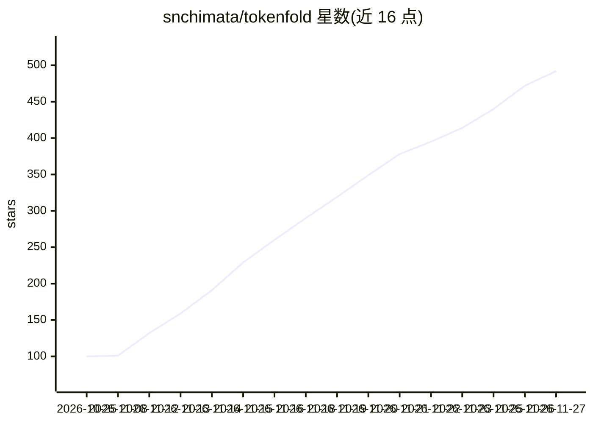

# snchimata/tokenfold

⭐ 492 · Rust · Apache-2.0 · 推送 2026-11-26 · [GitHub](https://github.com/snchimata/tokenfold) · 个人维护

**为 LLM 开发者提供本地可逆上下文压缩，节省 token 预算**

Tokenfold 是一个 provider 中立的上下文压缩工具：核心（Rust 实现）对文本、JSON、分组上下文与 provider 请求做无损结构压缩，在本地完成、不调用第三方服务，并输出可校验的 receipt。可选的 Tokenfold Select 组件（149.6M 参数评分模型）提供查询感知的相关性排序，需显式配置并单独获取模型文件。提供 Python/TypeScript SDK、CLI、MCP 服务器与 OpenAI 兼容本地代理等多种入口。默认路径离线、无需模型或 GPU。

## 筛选速览

| 维度 | 判定 | 备注 |
|---|---|---|
| AI 角色 | `ai-ecosystem` | LLM/agent 周边工具 |
| 许可风险 | `permissive` | Apache-2.0 |
| 部署形态 | `library` | 以包/库形式分发 |
| 模型依赖 | — | README 未给出锁定关系 |
| 硬件要求 | — | 无带数字的原话,不猜 |
| 安装摩擦 | `medium` | 含编译或系统依赖之一 |
| 成熟度 | — | 结构信号不足 |

## 能力要点

- 无损结构压缩：两个 fixture 上 45.6-63.9% token 节省，JSON 值可精确恢复
- 多种入口：Python/TypeScript SDK、CLI、MCP 服务器、OpenAI 兼容本地代理
- 可选 Select 评分模型（149.6M 参数）做查询感知相关性排序，需显式同意加载
- MCP 集成提供 compress/inspect/retrieve/stats 工具及 Git/构建/测试日志预置过滤器

## 适用场景

- 编码 Agent 处理大体积 shell 输出时压缩内容避免耗尽上下文窗口
- 在本地代理层压缩发往 OpenAI 兼容上游的请求以降低 token 消耗
- 将 JSON schema 与日志在本地可逆压缩后再交给模型

## 场景标签

 · 领域:LLM 基础设施/上下文管理

## 证据(README 行号)

> L9:  Python-first SDK. TypeScript alongside it. Rust at the core.
> L10:  One <code>fit()</code> workflow for text, JSON, grouped context, and provider requests.
> L160: Coding agents can exhaust context limits on large shell outputs. Tokenfold runs as a

## 星数曲线

2026-10-25 100 → 2026-11-27 492（+392）

---
*卡片 v1 · prompt 1.4 · 生成 2026-11-25 · 置信度 high · 依据 README sha `bea16192eed8` · [字段定义](../../DATASET.md)*
