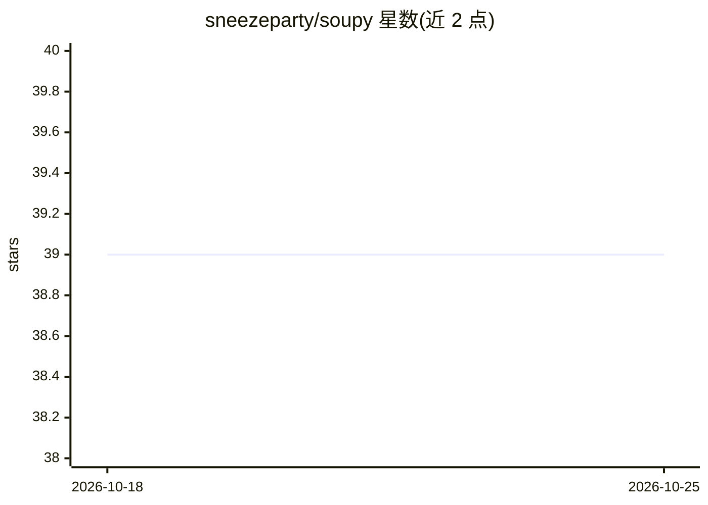

# sneezeparty/soupy

⭐ 39 · Python · 推送 2026-10-22 · [GitHub](https://github.com/sneezeparty/soupy) · 个人维护

**全本地 Discord 机器人：对话、RAG 记忆、自主发帖与图像生成**

双进程应用：Discord 机器人 + FastAPI 网页控制面板，全部运行在用户自有硬件上。聊天、嵌入、摘要与视觉经 LM Studio（或任意 OpenAI 兼容服务器）处理；图像生成有两条独立后端路径——远程 Stable Diffusion HTTP 后端与同机 Mac 上的 Flux/MLX 后端。机器人维护自我认知文档、构建用户画像、从 per-guild SQLite 归档做检索增强记忆，并可自主发布文章与 Bluesky 帖子。安装经 git clone 与交互式 install.py 完成，需 Python 3.10+ 与已加载聊天/嵌入模型的 LM Studio。

## 筛选速览

| 维度 | 判定 | 备注 |
|---|---|---|
| AI 角色 | `ai-native` | 本体是模型或模型工具 |
| 许可风险 | `none` | — |
| 部署形态 | `None` |  |
| 模型依赖 | — | README 未给出锁定关系 |
| 硬件要求 | — | 无带数字的原话,不猜 |
| 安装摩擦 | `low` | 无编译、无系统依赖或容器化 |
| 成熟度 | — | 结构信号不足 |

## 能力要点

- per-guild SQLite 归档 + 余弦相似度下限的检索增强记忆
- 双图像生成后端：远程 Stable Diffusion 与本地 Flux/MLX（含 FLUX.2 Klein-Edit）
- 可配置人格、自我认知文档与每夜自反思机制
- FastAPI 网页控制面板：进程控制、实时日志、配置编辑

## 适用场景

- 在自有服务器上运行有记忆和人格的 Discord 聊天机器人
- 自动归档服务器历史并按需检索回答
- 让机器人自主发布文章与 Bluesky 内容

## 场景标签

`聊天机器人` `RAG` `图像生成` · 领域:对话与助手

## 证据(README 行号)

> L5: A fully-local Discord bot with a configurable personality, retrieval-augmented memory of your server, autonomous Dis
> L17: Soupy is a two-process application — a Discord bot and a FastAPI web control panel that supervises it — built to ru
> L23: - Conversational chat with a configurable personality and a self-knowledge document Soupy maintains and rewrites ab

## 星数曲线

2026-10-18 39 → 2026-10-25 39（+0）

---
*卡片 v1 · prompt 1.4 · 生成 2026-10-25 · 置信度 high · 依据 README sha `68efc34889f6` · [字段定义](../../DATASET.md)*
