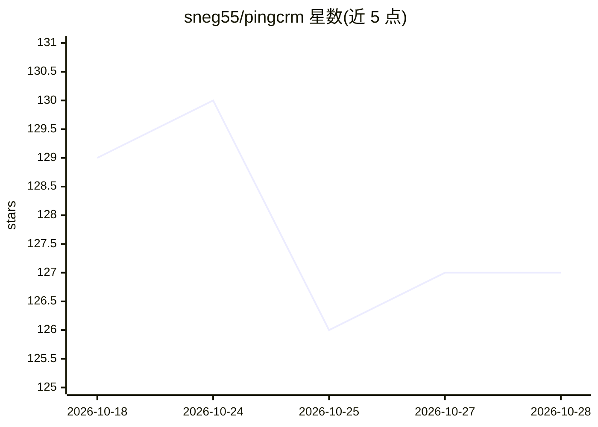

# sneg55/pingcrm

⭐ 127 · Python · AGPL-3.0 · 推送 2026-10-26 · [GitHub](https://github.com/sneg55/pingcrm) · [官网](https://pingcrm.xyz) · 个人维护

**可自托管的开源个人人脉 CRM，AI 生成跟进建议**

个人人际关系管理 CRM，支持自托管与一键部署到 Railway/Render/Fly.io 等平台。同步 Gmail、Telegram、Twitter/X、LinkedIn、WhatsApp，将邮件、私信、提及等聚合为统一联系人时间线；提供 0-10 关系评分、跨平台身份合并、多来源生活事件检测（换工作、生日、简介变更），并用 Claude（Anthropic API）起草上下文跟进消息，但不自动发送。内置 MCP server，可从 Claude Desktop、Cursor 等 MCP 客户端查询 CRM。技术栈为 FastAPI+PostgreSQL+Redis+Celery 后端与 Next.js 前端，Docker Compose 部署，AGPL-3.0 许可。

## 筛选速览

| 维度 | 判定 | 备注 |
|---|---|---|
| AI 角色 | `ai-enhanced` | 去掉 AI 部分产品仍成立 |
| 许可风险 | `viral` | AGPL-3.0 |
| 部署形态 | `self-host` | docker 或自建部署 |
| 模型依赖 | — | README 未给出锁定关系 |
| 硬件要求 | — | 无带数字的原话,不猜 |
| 安装摩擦 | `low` | 无编译、无系统依赖或容器化 |
| 成熟度 | — | 结构信号不足 |

## 能力要点

- 同步 Gmail/Telegram/Twitter/X/LinkedIn/WhatsApp 至统一联系人时间线
- 关系评分（0-10）与多来源生活事件检测
- AI 起草跟进消息，不自动发送
- 内置 MCP server，可被 Claude Desktop、Cursor 等 MCP 客户端查询

## 适用场景

- 管理个人人脉并看到哪些关系在变冷
- 聚合多平台沟通记录到单一联系人视图
- 让 AI 帮我起草有上下文的关系跟进消息

## 场景标签

`AI 助手` · 领域:对话与助手

## 证据(README 行号)

> L3: **Open-source personal networking CRM — AI-powered, self-hostable.**
> L9: Auto-syncs Gmail, Telegram, Twitter/X, LinkedIn, and WhatsApp. Detects life events. Drafts contextual follow-ups wit
> L32: - **AI suggestions** — drafts contextual follow-ups, never sends automatically

## 星数曲线

2026-10-18 129 → 2026-10-28 127（-2）

---
*卡片 v1 · prompt 1.4 · 生成 2026-10-22 · 置信度 high · 依据 README sha `6d4f5b7ea430` · [字段定义](../../DATASET.md)*
