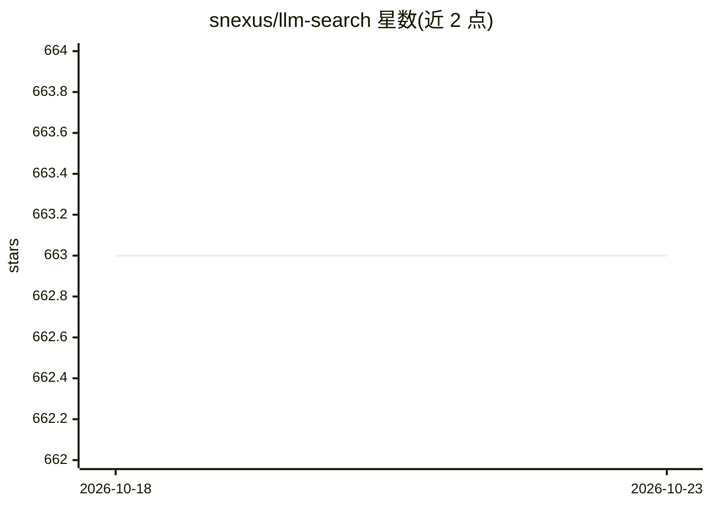

# snexus/llm-search

⭐ 663 · Jupyter Notebook · MIT · 推送 2026-01-17 · [GitHub](https://github.com/snexus/llm-search) · 个人维护

**面向本地文档问答的进阶 RAG 系统（YAML 配置）**

pyLLMSearch 提供基于 YAML 配置的本地文档问答（RAG）系统：解析 md/pdf/docx 等格式并做增量索引，支持 OpenAI 兼容 API、HuggingFace 模型及经 LiteLLM+Ollama 接入的本地模型；检索侧含 ChromaDB 稠密向量、SPLADE 稀疏向量混合搜索、HyDE、多查询与交叉编码器重排（ms-marco-MiniLM、bge-reranker-v2-m3、zerank-2）。通过内置 Web 界面、FastAPI 与 MCP server 交互，可供 Cursor/VSCode 等客户端调用。文档库测试规模为数 GB 级 markdown 与 PDF。

## 筛选速览

| 维度 | 判定 | 备注 |
|---|---|---|
| AI 角色 | `ai-ecosystem` | LLM/agent 周边工具 |
| 许可风险 | `permissive` | MIT |
| 部署形态 | `None` |  |
| 模型依赖 | local-ok | 支持本地模型 |
| 硬件要求 | — | 无带数字的原话,不猜 |
| 安装摩擦 | `low` | 无编译、无系统依赖或容器化 |
| 成熟度 | — | 结构信号不足 |

## 能力要点

- 混合检索（SPLADE 稀疏 + ChromaDB 稠密）与交叉编码器重排
- 支持 HyDE 与多查询（RAG Fusion 式）
- 增量索引，新文档无需重建全库
- 内置 Web 界面 + FastAPI + MCP server 供客户端接入

## 适用场景

- 对本地 markdown/PDF/docx 文档库做问答
- 在 Cursor/VSCode 等 MCP 客户端中查询自己的文档
- 学习新领域时用 HyDE 弥补术语表述差距

## 场景标签

 · 领域:RAG/文档问答

## 证据(README 行号)

> L7: The purpose of this package is to offer an advanced question-answering (RAG) system with a simple YAML-based configu
> L9: Interaction with the package is supported through the built-in frontend, or by exposing an MCP server, allowing clie

## 星数曲线

2026-10-18 663 → 2026-10-23 663（+0）

---
*卡片 v1 · prompt 1.4 · 生成 2026-10-21 · 置信度 mid · 依据 README sha `5eccd2bdf29b` · [字段定义](../../DATASET.md)*
