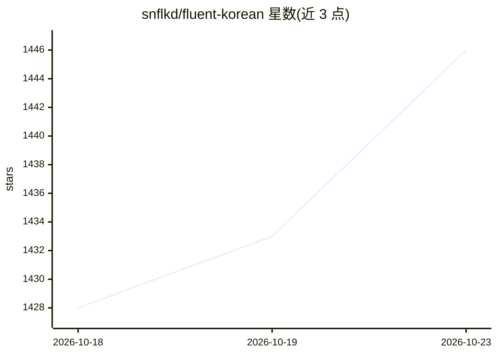

# snflkd/fluent-korean

⭐ 1,446 · MIT · 推送 2026-08-23 · [GitHub](https://github.com/snflkd/fluent-korean) · 个人维护

**让 Claude Code 输出清晰韩语的 output-style 插件**

以 Claude Code 插件形式提供的输出风格指令集：通过系统提示词在生成前约束 LLM（尤其是 Claude 与编码代理）使用带完整助词与语尾的韩语，避免省略成分的机器式韩文。包含两个变体：保留编码指令的 fluent-korean 与去除编码指令的 fluent-korean-not-coding；指导文本也可粘贴到 Claude 网页/桌面或其他 AI 环境的个人指令中使用。支持按需附加的细部行为块（敬语、避免生僻词等）。注意：会略微增加 token 消耗，指令多或任务长时效果可能减弱。

## 筛选速览

| 维度 | 判定 | 备注 |
|---|---|---|
| AI 角色 | `ai-ecosystem` | LLM/agent 周边工具 |
| 许可风险 | `permissive` | MIT |
| 部署形态 | `None` |  |
| 模型依赖 | locked-api |  |
| 硬件要求 | — | 无带数字的原话,不猜 |
| 安装摩擦 | `low` | 无编译、无系统依赖或容器化 |
| 成熟度 | — | 结构信号不足 |

## 能力要点

- 两个 output-style 变体：保留/去除 Claude Code 编码指令
- 指导文本可移植到 Claude 网页、桌面及其他 AI 环境
- 提供敬语、词汇选择、输出前自查等可选行为块
- README 提供经 LLM 协助安装的多环境适配说明

## 适用场景

- 韩语环境下让 Claude Code 的回答与产出使用完整自然的韩语
- 多代理或韩语提示词工作流中减少韩语质量劣化的累积
- 非 Claude Code 环境复用韩语写作指令

## 场景标签

 · 领域:LLM 提示工程/本地化

## 证据(README 行号)

> L3: 이 플러그인은 LLM, 특히 클로드와 코딩 에이전트가 명확한 한국어를 유창하게 구사하도록 지시하는 출력 스타일을 제공합니다.
> L32: 1. 이 도구는 기본적으로 output-style이므로, 시스템 프롬프트에 추가되어 한국어를 올바르게 사용하도록 **사전에** 규율합니다. (물론 필요에 따라 Skill 혹은 다른 방법으로도 사용하실 수 있

## 星数曲线

2026-10-18 1,428 → 2026-10-23 1,446（+18）

---
*卡片 v1 · prompt 1.4 · 生成 2026-10-21 · 置信度 high · 依据 README sha `724c83462a8a` · [字段定义](../../DATASET.md)*
