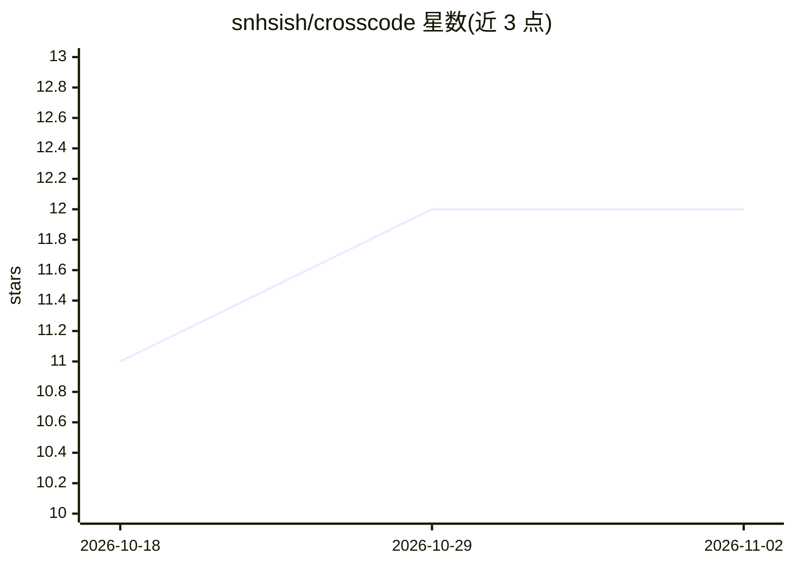

# snhsish/crosscode

⭐ 12 · TypeScript · MIT · 推送 2026-10-22 · [GitHub](https://github.com/snhsish/crosscode) · [官网](https://crosscode.site) · 个人维护

**手机远程控制 PC 上 OpenCode 编码 agent 的客户端**

CrossCode 将 PC 上运行的 OpenCode（终端 AI 编码 agent）会话通过安全隧道串流到手机，提供实时聊天、流式响应、内联 diff、工具调用审批、Git 面板、语音输入与推送通知。由 CLI（npx/npm 安装）启动 opencode serve 并建立隧道，隧道可选 Cloudflare/ngrok 免费通道或登录后的专属稳定 URL；代码不上传云端。手机端目前仅提供 Android 应用，需本机已安装 OpenCode 与 Node.js 20+（仅 CLI 包装需要）。

## 筛选速览

| 维度 | 判定 | 备注 |
|---|---|---|
| AI 角色 | `ai-ecosystem` | LLM/agent 周边工具 |
| 许可风险 | `permissive` | MIT |
| 部署形态 | `library` | 以包/库形式分发 |
| 模型依赖 | — | README 未给出锁定关系 |
| 硬件要求 | — | 无带数字的原话,不猜 |
| 安装摩擦 | `low` | 无编译、无系统依赖或容器化 |
| 成熟度 | — | 结构信号不足 |

## 能力要点

- 手机端实时查看与审批 OpenCode agent 的工具调用与 diff
- 免费 Cloudflare/ngrok 隧道或登录后专属稳定 URL 两种连接方式
- CLI 一键启动 opencode serve、开隧道并打印二维码
- 自托管 relay 选项（付费用户）

## 适用场景

- 出门在外时用手机继续操作 PC 上的编码 agent
- 在手机上审批工具调用、审查代码改动
- 远程管理多个 OpenCode 会话并接收推送通知

## 场景标签

`编码 Agent` · 领域:编码与开发

## 证据(README 行号)

> L5: Control your PC's OpenCode (the terminal AI coding agent) from your phone, from anywhere in the world. Free, open so
> L13: CrossCode streams a live OpenCode session from your computer to your phone over a secure tunnel. You get real-time 
> L88: ### macOS or Linux

## 星数曲线

2026-10-18 11 → 2026-11-02 12（+1）

---
*卡片 v1 · prompt 1.4 · 生成 2026-11-01 · 置信度 high · 依据 README sha `2a7a94710625` · [字段定义](../../DATASET.md)*
