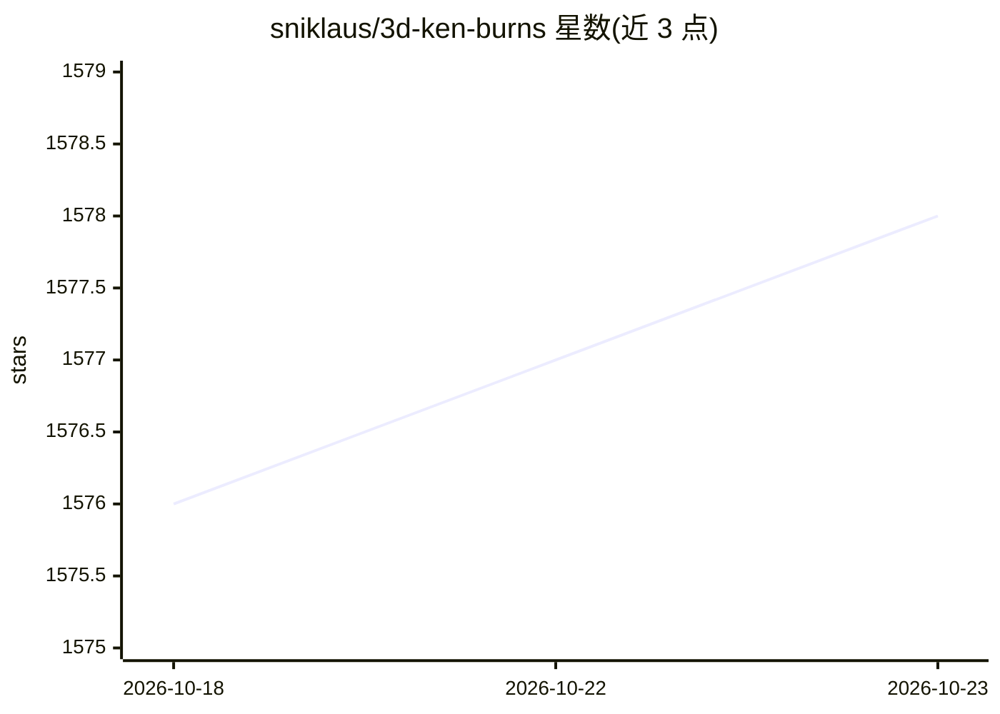

# sniklaus/3d-ken-burns

⭐ 1,578 · Python · NOASSERTION · 推送 2026-06-01 · [GitHub](https://github.com/sniklaus/3d-ken-burns) · 组织维护

**从单张图像生成 3D Ken Burns 效果视频的 PyTorch 实现**

Adobe Research 论文《3D Ken Burns Effect from a Single Image》的参考实现：读取单张静态图像，通过深度估计与虚拟相机扫描/缩放生成带运动视差的动画视频。提供全自动命令行（autozoom.py）、可手动调整相机路径的网页界面（localhost:8080）、独立深度估计脚本与基准验证脚本。部分函数以 CuPy 实现 CUDA 加速，需配置 CUDA_HOME，属必需依赖。采用 CC BY-NC-SA 4.0 许可，限非商业用途；另附带数据集与 Colab 运行途径。

## 筛选速览

| 维度 | 判定 | 备注 |
|---|---|---|
| AI 角色 | `ai-native` | 本体是模型或模型工具 |
| 许可风险 | `none` | NOASSERTION |
| 部署形态 | `library` | 以包/库形式分发 |
| 模型依赖 | — | README 未给出锁定关系 |
| 硬件要求 | — | 无带数字的原话,不猜 |
| 安装摩擦 | `medium` | 含编译或系统依赖之一 |
| 成熟度 | — | 结构信号不足 |

## 能力要点

- 单图输入自动生成带运动视差的 3D Ken Burns 动画视频
- 网页界面手动调整虚拟相机路径
- 独立深度估计脚本（depthestim.py）与 iBims/NYU 基准验证
- CuPy 实现 CUDA 加速的必需依赖

## 适用场景

- 把静态照片转成 3D 运镜视频
- 研究单图深度估计并跑基准验证
- 手动设计相机扫描路径生成动画

## 场景标签

 · 领域:计算机视觉/图像动画

## 证据(README 行号)

> L2: This is a reference implementation of 3D Ken Burns Effect from a Single Image [1] using PyTorch. Given a single inpu
> L11: Several functions are implemented in CUDA using CuPy, which is why CuPy is a required dependency. It can be install

## 星数曲线

2026-10-18 1,576 → 2026-10-23 1,578（+2）

---
*卡片 v1 · prompt 1.4 · 生成 2026-10-21 · 置信度 high · 依据 README sha `885b401878a4` · [字段定义](../../DATASET.md)*
