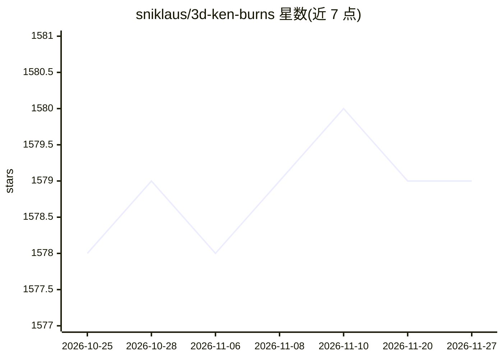

# sniklaus/3d-ken-burns

⭐ 1,579 · Python · NOASSERTION · 推送 2026-11-19 · [GitHub](https://github.com/sniklaus/3d-ken-burns) · 组织维护

**研究者/创作者：从单张图像生成 3D Ken Burns 效果视频**

论文《3D Ken Burns Effect from a Single Image》的 PyTorch 参考实现：输入单张静态图像，通过深度估计与虚拟相机扫动/缩放生成带运动视差的效果视频。提供全自动化命令行脚本（autozoom.py）、可手动调整相机路径的浏览器界面（interface.py）以及独立的深度估计脚本与基准脚本。依赖 CuPy 的 CUDA 实现，需配置 CUDA_HOME；作者另提供 Colab 云端运行方案与配套训练数据集（CC BY-NC-SA 4.0）。

## 筛选速览

| 维度 | 判定 | 备注 |
|---|---|---|
| AI 角色 | `ai-native` | 本体是模型或模型工具 |
| 许可风险 | `none` | NOASSERTION |
| 部署形态 | `library` | 以包/库形式分发 |
| 模型依赖 | — | README 未给出锁定关系 |
| 硬件要求 | — | 无带数字的原话,不猜 |
| 安装摩擦 | `medium` | 含编译或系统依赖之一 |
| 成熟度 | — | 结构信号不足 |

## 能力要点

- 单张图像全自动生成 3D Ken Burns 效果视频（autozoom.py）
- 浏览器界面手动调整虚拟相机路径（localhost:8080）
- 提供独立深度估计脚本及 ibims/nyu 基准验证
- 附带 CC BY-NC-SA 4.0 许可的场景数据集与相机姿态

## 适用场景

- 把单张照片制作为带视差的扫动缩放视频
- 获取单张图像的原始深度估计
- 在 Colab 云端环境运行效果生成
- 使用配套数据集开展相关研究

## 场景标签

`视频生成` · 领域:内容生成

## 证据(README 行号)

> L2: This is a reference implementation of 3D Ken Burns Effect from a Single Image [1] using PyTorch. Given a single inpu
> L13: Several functions are implemented in CUDA using CuPy, which is why CuPy is a required dependency. It can be install

## 星数曲线

2026-10-25 1,578 → 2026-11-27 1,579（+1）

---
*卡片 v1 · prompt 1.4 · 生成 2026-11-24 · 置信度 high · 依据 README sha `ebec8ddc2fdf` · [字段定义](../../DATASET.md)*
