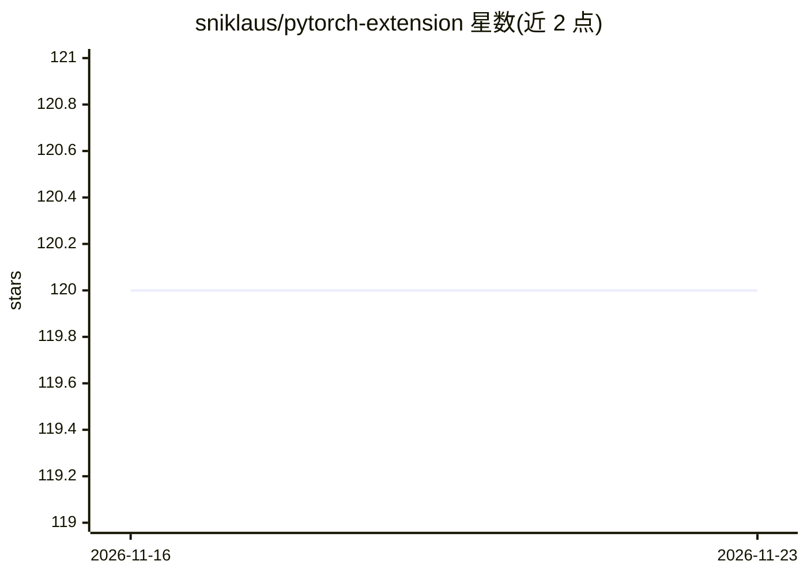

# sniklaus/pytorch-extension

⭐ 120 · Python · GPL-3.0 · 推送 2026-11-15 · [GitHub](https://github.com/sniklaus/pytorch-extension) · 个人维护

**PyTorch 的 CuPy CUDA 扩展示例：计算两个张量的 Hadamard 积**

一个演示如何用 CuPy 为 PyTorch 编写 CUDA 扩展/函数/层的示例仓库，实现两个张量的逐元素 Hadamard 乘积。无需单独构建过程，安装 CuPy 后直接 python run.py 即可测试。面向希望学习自定义 CUDA 层写法的深度学习开发者，README 还链接了同一作者另外两个更复杂的 CuPy 扩展项目。

## 筛选速览

| 维度 | 判定 | 备注 |
|---|---|---|
| AI 角色 | `ai-ecosystem` | LLM/agent 周边工具 |
| 许可风险 | `viral` | GPL-3.0 |
| 部署形态 | `library` | 以包/库形式分发 |
| 模型依赖 | — | README 未给出锁定关系 |
| 硬件要求 | — | 无带数字的原话,不猜 |
| 安装摩擦 | `medium` | 含编译或系统依赖之一 |
| 成熟度 | — | 结构信号不足 |

## 能力要点

- 用 CuPy 实现 PyTorch 自定义 CUDA 层的示例
- 计算两个张量的 Hadamard 积
- 无需单独构建步骤，可直接运行 run.py 测试

## 适用场景

- 学习如何为 PyTorch 编写 CuPy CUDA 扩展
- 作为自定义 CUDA 层的起点模板

## 场景标签

`教程课程` · 领域:学习与行业

## 证据(README 行号)

> L2: This is an example of a CUDA extension/function/layer for PyTorch which uses CuPy to compute the Hadamard product of

## 星数曲线

2026-11-16 120 → 2026-11-23 120（+0）

---
*卡片 v1 · prompt 1.4 · 生成 2026-11-17 · 置信度 mid · 依据 README sha `4a4b55913367` · [字段定义](../../DATASET.md)*
