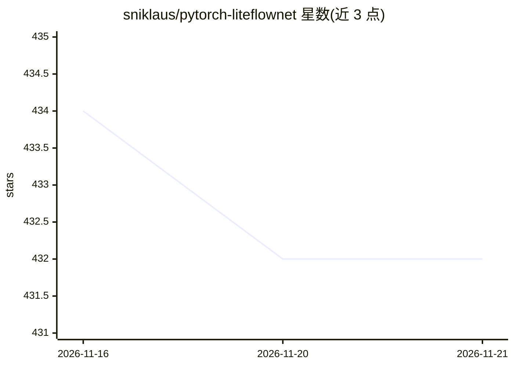

# sniklaus/pytorch-liteflownet

⭐ 432 · Python · GPL-3.0 · 推送 2026-11-15 · [GitHub](https://github.com/sniklaus/pytorch-liteflownet) · 个人维护

**LiteFlowNet 光流估计神经网络的 PyTorch 复现实现**

对 CVPR 2018 论文 LiteFlowNet 的个人 PyTorch 复现，目标是与官方 Caffe 版本结果一致。核心的 correlation 层使用 CUDA 经 CuPy 实现，CuPy 为必需依赖。提供 run.py 脚本对一对图像运行三种模型并输出 .flo 光流文件；存在因 Caffe DownsampleLayer 与 PyTorch interpolate 差异导致的数值偏差，作者不保证实现完全正确。原作材料仅限研究用途，使用需引用论文并遵守原许可条款。

## 筛选速览

| 维度 | 判定 | 备注 |
|---|---|---|
| AI 角色 | `ai-native` | 本体是模型或模型工具 |
| 许可风险 | `viral` | GPL-3.0 |
| 部署形态 | `library` | 以包/库形式分发 |
| 模型依赖 | — | README 未给出锁定关系 |
| 硬件要求 | — | 无带数字的原话,不猜 |
| 安装摩擦 | `medium` | 含编译或系统依赖之一 |
| 成熟度 | — | 结构信号不足 |

## 能力要点

- LiteFlowNet 的 PyTorch 复现，与官方 Caffe 版本结果一致（示例范围内）
- correlation 层以 CUDA/CuPy 实现
- 支持三种模型选择，输出 .flo 光流文件

## 适用场景

- 对图像对进行光流估计并输出结果
- 在 PyTorch 代码基础上复现或研究 LiteFlowNet

## 场景标签

`图像视频处理` · 领域:感知与多模态

## 证据(README 行号)

> L2: This is a personal reimplementation of LiteFlowNet [1] using PyTorch. Should you be making use of this work, please 
> L11: The correlation layer is implemented in CUDA using CuPy, which is why CuPy is a required dependency. It can be inst

## 星数曲线

2026-11-16 434 → 2026-11-21 432（-2）

---
*卡片 v1 · prompt 1.4 · 生成 2026-11-17 · 置信度 mid · 依据 README sha `c7a4e65f27b9` · [字段定义](../../DATASET.md)*
