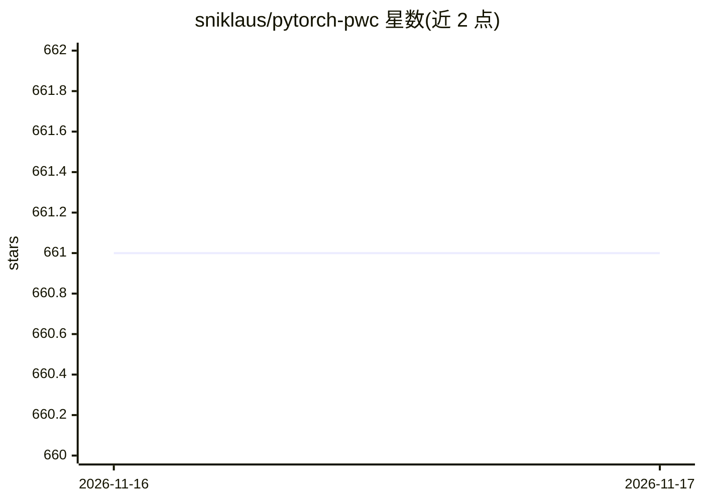

# sniklaus/pytorch-pwc

⭐ 661 · Python · GPL-3.0 · 推送 2026-11-15 · [GitHub](https://github.com/sniklaus/pytorch-pwc) · 个人维护

**PWC-Net 光流估计的 PyTorch 复现，复刻官方 Caffe 版性能**

Simon Niklaus 个人维护的 PWC-Net（CVPR 2018 光流网络）PyTorch 复现，通过使用官方 Caffe 版权重复刻其性能。相关层（correlation layer）以 CuPy 编写 CUDA 实现，CuPy 为必需依赖。提供 run.py 脚本对成对图像计算光流并输出 .flo 文件，支持两个模型变体。作者声明不保证实现完全正确，示例中结果与 Caffe 版一致；模型遵循原作者非商业相同方式共享许可。

## 筛选速览

| 维度 | 判定 | 备注 |
|---|---|---|
| AI 角色 | `ai-native` | 本体是模型或模型工具 |
| 许可风险 | `viral` | GPL-3.0 |
| 部署形态 | `library` | 以包/库形式分发 |
| 模型依赖 | — | README 未给出锁定关系 |
| 硬件要求 | — | 无带数字的原话,不猜 |
| 安装摩擦 | `medium` | 含编译或系统依赖之一 |
| 成熟度 | — | 结构信号不足 |

## 能力要点

- 复用官方 Caffe 权重以复刻原版性能
- correlation 层以 CuPy 实现 CUDA 加速
- 提供 run.py 命令行对图像对输出光流（.flo）

## 适用场景

- 对两帧图像计算稠密光流
- 在 CUDA 环境受限场景下运行 PWC-Net 推理
- 光流研究中的可复现基线实现

## 场景标签

`图像视频处理` · 领域:感知与多模态

## 证据(README 行号)

> L2: This is a personal reimplementation of PWC-Net [1] using PyTorch. Should you be making use of this work, please cite
> L11: The authors of PWC-Net are thankfully already providing a reference implementation in PyTorch. However, its initial
> L16: The correlation layer is implemented in CUDA using CuPy, which is why CuPy is a required dependency. It can be inst

## 星数曲线

2026-11-16 661 → 2026-11-17 661（+0）

---
*卡片 v1 · prompt 1.4 · 生成 2026-11-17 · 置信度 mid · 依据 README sha `c670b045abc5` · [字段定义](../../DATASET.md)*
