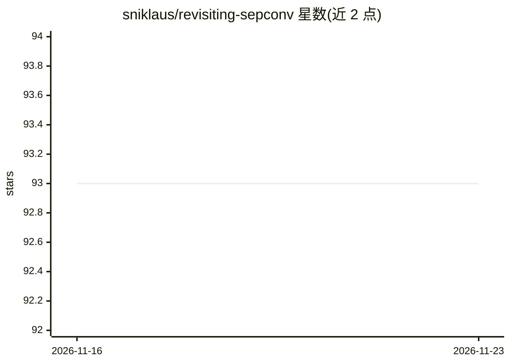

# sniklaus/revisiting-sepconv

⭐ 93 · Python · NOASSERTION · 推送 2026-11-15 · [GitHub](https://github.com/sniklaus/revisiting-sepconv) · 个人维护

**视频帧插值论文的 PyTorch 参考实现：两帧生成中间帧**

Revisiting Adaptive Convolutions for Video Frame Interpolation (WACV 2021) 的官方参考实现，基于 PyTorch。给定两帧，利用可分离方式的自适应卷积生成中间插值帧。核心的可分离卷积层用 CUDA 与 CuPy 实现，CuPy 为必需依赖；处理视频需另装 moviepy。提供 run.py 处理单对图像或整段视频，附带 Middlebury 基准示例的 benchmark.py 用于验证实现运行正确。作者要求使用者引用论文。

## 筛选速览

| 维度 | 判定 | 备注 |
|---|---|---|
| AI 角色 | `ai-native` | 本体是模型或模型工具 |
| 许可风险 | `none` | NOASSERTION |
| 部署形态 | `library` | 以包/库形式分发 |
| 模型依赖 | — | README 未给出锁定关系 |
| 硬件要求 | — | 无带数字的原话,不猜 |
| 安装摩擦 | `medium` | 含编译或系统依赖之一 |
| 成熟度 | — | 结构信号不足 |

## 能力要点

- 两帧输入，自适应卷积（可分离方式）生成中间帧
- 可分离卷积层以 CUDA + CuPy 实现
- 支持单对图像与整段视频两种处理模式
- 附 benchmark.py 用于 Middlebury 基准验证

## 适用场景

- 对一对图像生成中间插值帧
- 对视频逐段做帧插值处理
- 复现论文结果并验证实现正确性

## 场景标签

`视频生成` · 领域:内容生成

## 证据(README 行号)

> L2: This is a reference implementation of Revisiting Adaptive Convolutions for Video Frame Interpolation [1] using PyTor
> L11: The separable convolution layer is implemented in CUDA using CuPy, which is why CuPy is a required dependency. It c

## 星数曲线

2026-11-16 93 → 2026-11-23 93（+0）

---
*卡片 v1 · prompt 1.4 · 生成 2026-11-17 · 置信度 high · 依据 README sha `e56a039fb865` · [字段定义](../../DATASET.md)*
