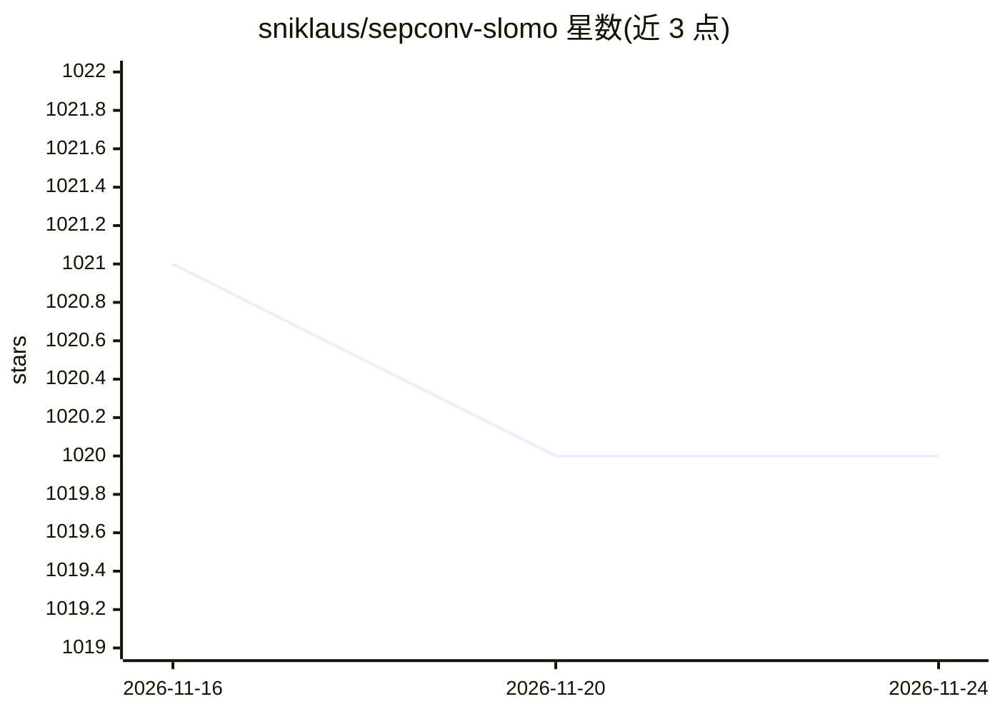

# sniklaus/sepconv-slomo

⭐ 1,020 · Python · 推送 2026-11-15 · [GitHub](https://github.com/sniklaus/sepconv-slomo) · 个人维护

**自适应可分离卷积视频帧插值的 PyTorch 参考实现**

论文 Video Frame Interpolation via Adaptive Separable Convolution（ICCV 2017）的 PyTorch 参考实现：给定两帧，以自适应可分离卷积方式插值出中间帧。可处理成对图片或整个视频，提供 l1（定量评估）与 lf（定性对比）两种模型，附 Middlebury 光流基准示例用于验证运行。核心卷积层用 CUDA/CuPy 实现，CuPy 为必需依赖，处理视频需另装 moviepy。许可证限学术用途，商业使用需联系作者。README 首行声明本工作已被 revisiting-sepconv 取代。

## 筛选速览

| 维度 | 判定 | 备注 |
|---|---|---|
| AI 角色 | `ai-native` | 本体是模型或模型工具 |
| 许可风险 | `none` | — |
| 部署形态 | `library` | 以包/库形式分发 |
| 模型依赖 | — | README 未给出锁定关系 |
| 硬件要求 | — | 无带数字的原话,不猜 |
| 安装摩擦 | `medium` | 含编译或系统依赖之一 |
| 成熟度 | — | 结构信号不足 |

## 能力要点

- 两帧间自适应可分离卷积插值生成中间帧
- 支持图片对与整段视频两种处理模式
- 提供 l1/lf 两种模型与 Middlebury 基准脚本
- 卷积层以 CUDA/CuPy 实现，需 GPU 环境

## 适用场景

- 我对两帧之间做中间帧插值生成慢动作效果
- 我用它复现 sepconv 论文的定量/定性实验
- 我验证视频帧插值算法在自有数据上的效果

## 场景标签

`图像视频处理` · 领域:感知与多模态

## 证据(README 行号)

> L4: This is a reference implementation of Video Frame Interpolation via Adaptive Separable Convolution [1] using PyTorch
> L15: The separable convolution layer is implemented in CUDA using CuPy, which is why CuPy is a required dependency. It c

## 星数曲线

2026-11-16 1,021 → 2026-11-24 1,020（-1）

---
*卡片 v1 · prompt 1.4 · 生成 2026-11-17 · 置信度 high · 依据 README sha `548f932f1143` · [字段定义](../../DATASET.md)*
