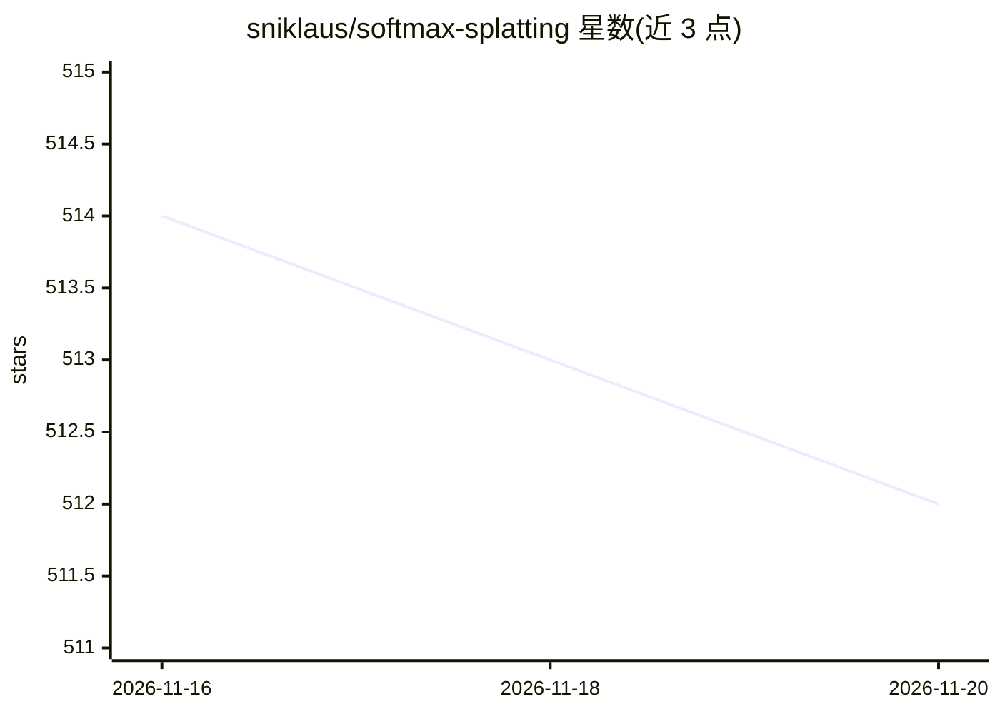

# sniklaus/softmax-splatting

⭐ 512 · Python · 推送 2026-11-15 · [GitHub](https://github.com/sniklaus/softmax-splatting) · 个人维护

**可微分前向变形 softmax splatting 算子的 PyTorch 参考实现**

论文 Softmax Splatting for Video Frame Interpolation（CVPR 2020）的参考实现：提供 softmax splatting 可微前向变形算子，用平移不变的重要性度量解决多源像素映射到同一目标像素的歧义。CUDA kernel 基于 CuPy 实现，运行需 CUDA 与 CuPy。提供 run.py 对图像对或视频做帧插值，附 Middlebury 与 Xiph 4K 基准复现脚本及论文图三的变形对比脚本。许可仅限学术用途，商用需联系作者。

## 筛选速览

| 维度 | 判定 | 备注 |
|---|---|---|
| AI 角色 | `ai-native` | 本体是模型或模型工具 |
| 许可风险 | `none` | — |
| 部署形态 | `library` | 以包/库形式分发 |
| 模型依赖 | — | README 未给出锁定关系 |
| 硬件要求 | — | 无带数字的原话,不猜 |
| 安装摩擦 | `medium` | 含编译或系统依赖之一 |
| 成熟度 | — | 结构信号不足 |

## 能力要点

- softmax splatting 可微分前向变形算子实现
- CuPy/CUDA 实现的 splatting kernel
- 支持图像对与视频的帧插值运行脚本
- 提供 Middlebury 与 Xiph 4K 基准脚本

## 适用场景

- 复现论文的 softmax splatting 变形结果
- 对图像对或视频执行可微前向变形帧插值
- 在前向变形研究中对比 summation/average/linear/softmax splatting

## 场景标签

`图像视频处理` `科研工具` · 领域:学习与行业

## 证据(README 行号)

> L2: This is a reference implementation of the softmax splatting operator, which has been proposed in Softmax Splatting f
> L9: The softmax splatting is implemented in CUDA using CuPy, which is why CuPy is a required dependency. It can be insta

## 星数曲线

2026-11-16 514 → 2026-11-20 512（-2）

---
*卡片 v1 · prompt 1.4 · 生成 2026-11-17 · 置信度 high · 依据 README sha `987adec09a43` · [字段定义](../../DATASET.md)*
