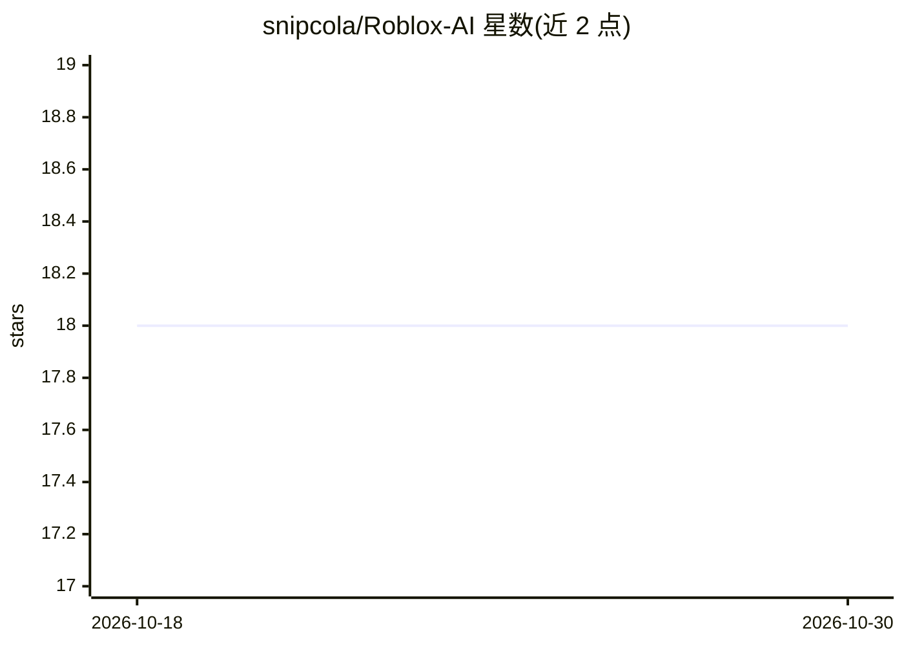

# snipcola/Roblox-AI

⭐ 18 · TypeScript · MIT · 推送 2026-01-03 · [GitHub](https://github.com/snipcola/Roblox-AI) · 个人维护

**在 Roblox 中以 AI 自动操控角色并与人对话的脚本**

基于 Lua 脚本的 Roblox 自动化工具：通过脚本执行器加载，使用 getgenv 配置，使角色自动行动并与其他玩家交流，支持自定义函数。项目基于 Create-Roblox-TS-Script 创建，编译需参照该模板。README 仅展示配置片段，具体模型接入方式与运行细节未在可见范围内说明。

## 筛选速览

| 维度 | 判定 | 备注 |
|---|---|---|
| AI 角色 | `ai-native` | 本体是模型或模型工具 |
| 许可风险 | `permissive` | MIT |
| 部署形态 | `None` |  |
| 模型依赖 | — | README 未给出锁定关系 |
| 硬件要求 | — | 无带数字的原话,不猜 |
| 安装摩擦 | `low` | 无编译、无系统依赖或容器化 |
| 成熟度 | — | 结构信号不足 |

## 能力要点

- 自动操控 Roblox 角色并实现与他人的交流
- 通过 getgenv 全局表进行脚本配置
- 支持自定义函数扩展

## 适用场景

- 在 Roblox 游戏中让 AI 角色自动行动与对话
- 通过自定义函数扩展 AI 行为

## 场景标签

`聊天机器人` · 领域:对话与助手

## 证据(README 行号)

> L3: Automates your Roblox character, enabling communication with others and custom functions.
> L4: **Note:** This project was created with Create-Roblox-TS-Script, refer there for compilation.

## 星数曲线

2026-10-18 18 → 2026-10-30 18（+0）

---
*卡片 v1 · prompt 1.4 · 生成 2026-10-29 · 置信度 low · 依据 README sha `9c16c7489b59` · [字段定义](../../DATASET.md)*
