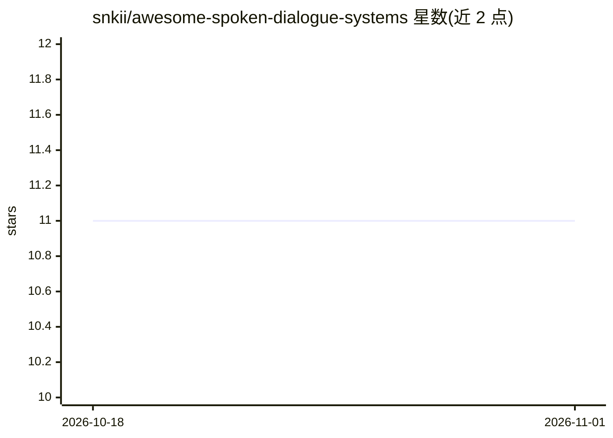

# snkii/awesome-spoken-dialogue-systems

⭐ 11 · CC0-1.0 · 推送 2026-08-07 · [GitHub](https://github.com/snkii/awesome-spoken-dialogue-systems) · 个人维护

**口语对话系统研究论文与工具的策展清单**

策展型 awesome 清单，聚焦以语音为主要界面的实时对话 agent。收录 2023-2025 年研究论文（含全双工语音对话、流式思考/推理、backchannel 与填充语建模、音频编解码器）、多个评测基准（VoiceBench、SD-Eval、Full-Duplex-Bench 系列等）、两个工具包（Pipecat、ESPnet-SDS）及相关 awesome 清单。面向语音对话方向的研究者与开发者，用于追踪领域文献与工具。清单自述为 curation 而非 collection，仅收录推进语音优先对话系统的资源。

## 筛选速览

| 维度 | 判定 | 备注 |
|---|---|---|
| AI 角色 | `ai-knowledge` | 知识聚合/清单类 |
| 许可风险 | `viral` | CC0-1.0 |
| 部署形态 | `None` |  |
| 模型依赖 | — | README 未给出锁定关系 |
| 硬件要求 | — | 无带数字的原话,不猜 |
| 安装摩擦 | `low` | 无编译、无系统依赖或容器化 |
| 成熟度 | — | 结构信号不足 |

## 能力要点

- 按 Surveys/Papers/Benchmarks/Toolkits 分类组织
- 覆盖全双工语音对话、流式推理、音频编解码器等子方向
- 收录 VoiceBench、Full-Duplex-Bench 系列等评测基准
- 收录 Pipecat、ESPnet-SDS 两个开源工具包

## 适用场景

- 查找口语对话系统方向的综述与研究论文
- 选择语音对话系统评测基准
- 发现构建实时语音 agent 的开源工具包

## 场景标签

`精选清单` `科研工具` · 领域:学习与行业

## 证据(README 行号)

> L5: A curated list of **awesome spoken dialogue systems**, focusing on speech-first, real-time conversational agents.
> L8: This is a curation, not a collection. Only resources that meaningfully advance spoken dialogue systems toward that g

## 星数曲线

2026-10-18 11 → 2026-11-01 11（+0）

---
*卡片 v1 · prompt 1.4 · 生成 2026-11-01 · 置信度 high · 依据 README sha `c1c36ffc9528` · [字段定义](../../DATASET.md)*
