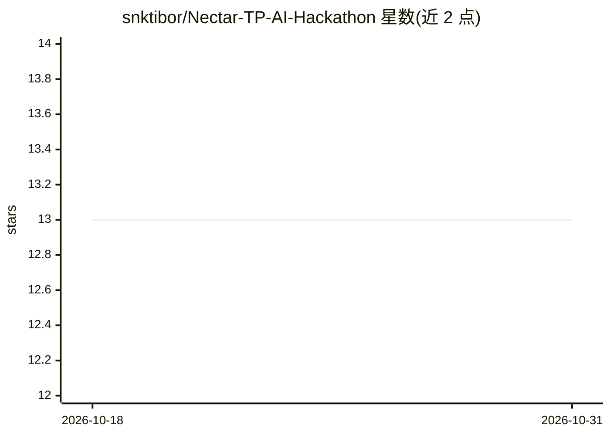

# snktibor/Nectar-TP-AI-Hackathon

⭐ 13 · Python · NOASSERTION · 推送 2026-09-25 · [GitHub](https://github.com/snktibor/Nectar-TP-AI-Hackathon) · 组织维护

**RAG 多智能体转移定价文档预审计系统（黑客松作品）**

PwC Hungary AI Hackathon 2026 参赛项目：对转移定价文档（Master File、Local File、基准研究、合同、发票）做自动化跨文档一致性检查与税务稽查风险预筛。 ingestion 流水线对 PDF/DOCX 分类、语义切块并混合向量化（dense+BM25），6 个专项智能体以 Tool-Use 循环协作产出带引用与置信度的 finding，一键生成 PDF 合规报告。使用 Anthropic Claude API（自研编排，不用 LangChain），全栈源码形式发布，仅供展示与作品集用途，未给安装命令。

## 筛选速览

| 维度 | 判定 | 备注 |
|---|---|---|
| AI 角色 | `ai-native` | 本体是模型或模型工具 |
| 许可风险 | `none` | NOASSERTION |
| 部署形态 | `None` |  |
| 模型依赖 | locked-api |  |
| 硬件要求 | — | 无带数字的原话,不猜 |
| 安装摩擦 | `low` | 无编译、无系统依赖或容器化 |
| 成熟度 | — | 结构信号不足 |

## 能力要点

- PDF/DOCX 自动分类、语义切块与混合 dense+BM25 向量化
- 6 个专项智能体（Master File/Local File/基准/合同/发票/跨文档一致性）协作审计
- 每条 finding 附来源引用、法规背景与置信度
- 一键生成 20+ 页转移定价合规报告（含财务风险估计与整改计划）

## 适用场景

- 会计师/税务团队在官方稽查前自查转移定价文档一致性
- 为跨境关联交易文档生成可交付客户的合规报告
- 批量处理 Master File 与 Local File 的交叉核对

## 场景标签

`多智能体` `RAG` `文档解析` · 领域:Agent 开发

## 证据(README 行号)

> L17: A **Nectar TP** a *Kerek Barackok* csapat által fejlesztett, domain-specifikus, RAG-alapú multi-ágens pre-audit ren
> L22: * **Multi-Ágens Architektúra:** 6 dedikált specialista ágens (Master File, Local File, Benchmark, Szerződés, Számla

## 星数曲线

2026-10-18 13 → 2026-10-31 13（+0）

---
*卡片 v1 · prompt 1.4 · 生成 2026-10-31 · 置信度 high · 依据 README sha `d9961e6f2e4c` · [字段定义](../../DATASET.md)*
