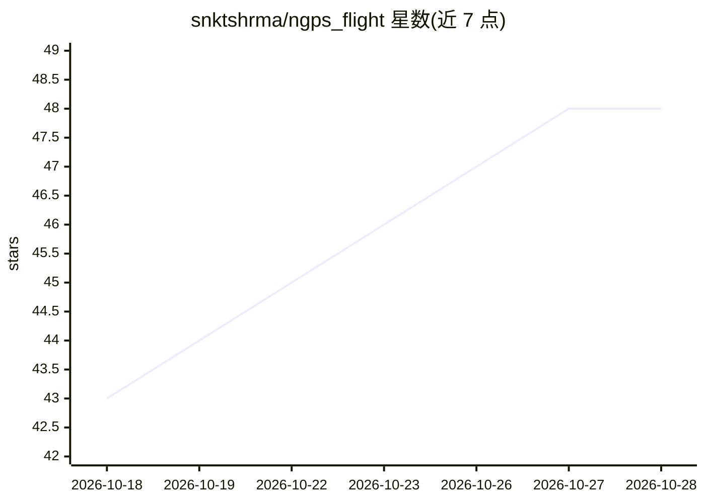

# snktshrma/ngps_flight

⭐ 48 · Python · MIT · 推送 2026-10-27 · [GitHub](https://github.com/snktshrma/ngps_flight) · 个人维护

**无人机 GPS 拒止环境下的视觉全局定位系统**

面向高海拔无人机在无 GPS 环境导航的视觉地理定位系统：以下视相机图像与卫星参考图像做深度学习特征匹配（LightGlue/SuperPoint），以 1-2 Hz 输出绝对位置估计；另含 UKF 多传感器融合节点（融合 NGPS、VIO、IMU）、单目视觉里程计节点与基于 AKAZE+MAGSAC 的轻量地图匹配 VPS 节点，融合输出送 ArduPilot EKF。以 ROS 2 包形式提供，目标平台为 NVIDIA Jetson Orin（JetPack 7.2），通过 Docker/Distrobox 容器构建运行，需自行构建 TensorRT 引擎。声明仅限研究与教育用途，WIP 状态，部分功能在 TODO 中。

## 筛选速览

| 维度 | 判定 | 备注 |
|---|---|---|
| AI 角色 | `ai-native` | 本体是模型或模型工具 |
| 许可风险 | `permissive` | MIT |
| 部署形态 | `self-host` | docker 或自建部署 |
| 模型依赖 | — | README 未给出锁定关系 |
| 硬件要求 | — | 无带数字的原话,不猜 |
| 安装摩擦 | `low` | 无编译、无系统依赖或容器化 |
| 成熟度 | `idea` | |

## 能力要点

- 下视相机图像与卫星参考图像的深度学习特征匹配（LightGlue/SuperPoint，1-2 Hz 绝对定位）
- UKF 融合 NGPS 绝对位置、VIO 相对位姿与 IMU，输出 10-20 Hz 里程计
- 附独立单目视觉里程计（SIFT+solvePnPRansac）与 AKAZE+MAGSAC 轻量 VPS 备选管线
- 提供 SITL 仿真、启动脚本、rosbag 录制回放与相机-IMU 标定文档

## 适用场景

- GPS 拒止环境下无人机飞行的绝对定位与 VIO 漂移校正
- 在 ArduPilot SITL 仿真中验证非 GPS 导航全栈
- 无人机多传感器（视觉定位+VIO+IMU）融合状态估计研究

## 场景标签

 · 领域:机器人/无人机导航

## 证据(README 行号)

> L19: This codebase implements a visual geo-localization system for drones that matches down-facing camera images against
> L23: - **ap_ngps_ros2**: ROS2 node that performs visual geo-localization by matching camera images to satellite referenc

## 星数曲线

2026-10-18 43 → 2026-10-28 48（+5）

---
*卡片 v1 · prompt 1.4 · 生成 2026-10-25 · 置信度 high · 依据 README sha `954d7177e77d` · [字段定义](../../DATASET.md)*
