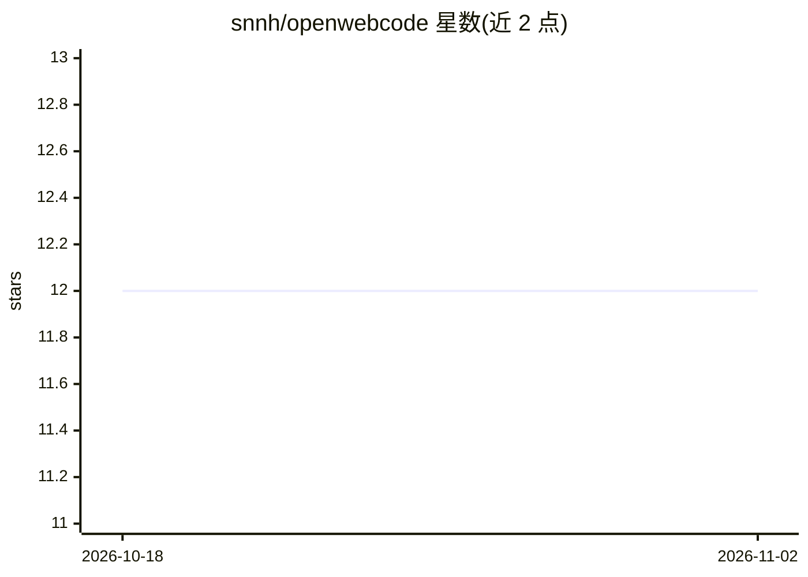

# snnh/openwebcode

⭐ 12 · TypeScript · Apache-2.0 · 推送 2026-11-01 · [GitHub](https://github.com/snnh/openwebcode) · 个人维护 · 中文 README

**浏览器即用的 AI 编码工作台，agent 读写代码、跑命令、管沙盒**

跑在浏览器里的自托管 AI 编码工作台，由 React 前端、Node 服务层（Agent 循环、工具调度、权限）与 C 执行器（命令/文件/沙盒/快照）三层组成。用户配置模型服务商（Anthropic Messages / OpenAI Chat Completions / OpenAI Responses 三类接口）后，由 agent 完成代码读写、测试、符号索引、终端操作等任务。支持子代理集群、MCP 与第三方扩展、上下文压缩、定时任务、Headless CLI（NDJSON）及 CI 集成。沙盒覆盖 Windows Job Object/AppContainer 与 Linux bubblewrap/Landlock。提供 Windows MSI、Linux 安装脚本、tar.gz 与 Docker 镜像，支持 x86-64/arm64/loongarch64；未安装 bubblewrap 的 Linux 环境默认沙盒档会报错需手动处理。

## 筛选速览

| 维度 | 判定 | 备注 |
|---|---|---|
| AI 角色 | `ai-ecosystem` | LLM/agent 周边工具 |
| 许可风险 | `permissive` | Apache-2.0 |
| 部署形态 | `desktop` | 安装包/桌面程序 |
| 模型依赖 | — | README 未给出锁定关系 |
| 硬件要求 | — | 无带数字的原话,不猜 |
| 安装摩擦 | `low` | 无编译、无系统依赖或容器化 |
| 成熟度 | — | 结构信号不足 |

## 能力要点

- agent 完成代码读写、命令执行、符号索引与测试诊断
- 沙盒机制：Windows Job Object/AppContainer/WSB，Linux bubblewrap/Landlock
- 支持 Skills、斜杠命令、Hooks、自定义子代理、MCP 与 Extension Host 扩展
- owc run CLI 输出 NDJSON 事件流，支持 CI 集成与工具范围限制

## 适用场景

- 在本地或服务器自托管一个浏览器访问的 AI 编码工作台
- 让 agent 在沙盒内读写代码、跑测试并管理 git 快照
- 在 CI 中用 Headless CLI 驱动 agent 执行编码任务
- 低配置设备上运行 AI 编码代理（server 空闲约 74 MiB 内存）

## 场景标签

`编码 Agent` · 领域:编码与开发

## 证据(README 行号)

> L11: OpenWebCode 是一个跑在浏览器里的 AI 编码工作台，界面中英双语，原生支持 Windows (x86-64) 和 Linux (x86-64 / arm64 / loongarch64)。装好后用浏览器打开，就能让 a
> L38: - **多模型适配**：支持 Anthropic Messages / OpenAI Chat Completions / OpenAI Responses 三大接口；**运行中可直接更换模型与思考档**（不打断在途请求，下一轮生
> L105: 1. 在 **设置 → 模型目录** 添加并启用一个模型服务商（Anthropic Messages / OpenAI Chat Completions / OpenAI Responses），然后刷新模型目录。

## 星数曲线

2026-10-18 12 → 2026-11-02 12（+0）

---
*卡片 v1 · prompt 1.4 · 生成 2026-11-01 · 置信度 high · 依据 README sha `1e11a9bab435` · [字段定义](../../DATASET.md)*
