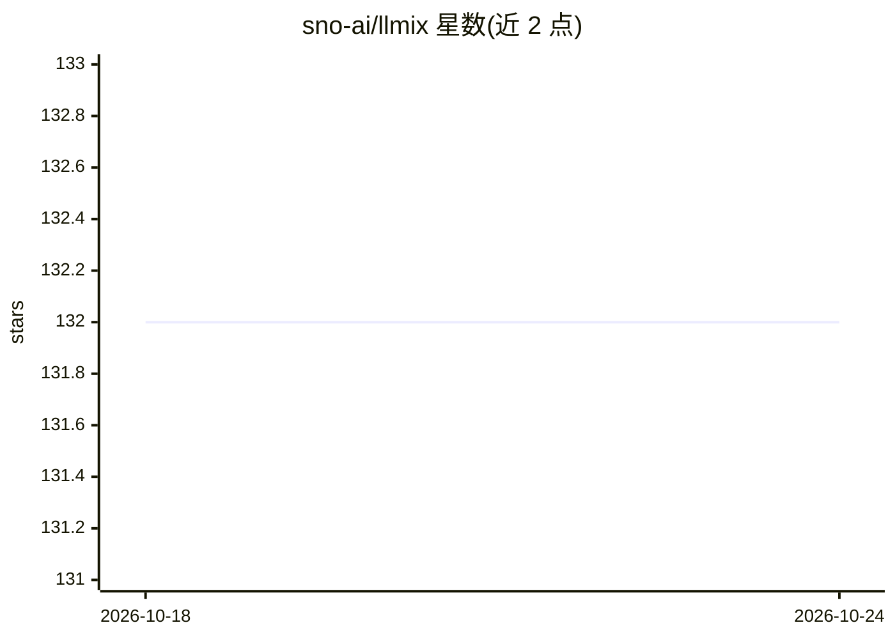

# sno-ai/llmix

⭐ 132 · Python · Apache-2.0 · 推送 2026-10-17 · [GitHub](https://github.com/sno-ai/llmix) · [官网](https://github.com/sno-ai/llmix) · 组织维护

**给 AI agent 开发者的 LLM 调用治理层：缓存/重试/密钥池/热切换**

位于产品代码与提供商 SDK 之间的调用包装层，支持 Python/TypeScript/Rust 三语言对等 API。不要求改写 OpenAI/Anthropic/Gemini/LiteLLM/AI SDK 等现有客户端，而是在调用外围提供响应缓存（内存+可选 Redis）、密钥池轮换、抖动重试、熔断器、singleflight、AIMD 自适应并发与遥测。模型选择以 MDA 预设为数据加载，经签名编译注册表发布后热切换模型/提供商，无需重新部署。明确声明不是流式框架、prompt 框架或路由器。

## 筛选速览

| 维度 | 判定 | 备注 |
|---|---|---|
| AI 角色 | `ai-ecosystem` | LLM/agent 周边工具 |
| 许可风险 | `permissive` | Apache-2.0 |
| 部署形态 | `library` | 以包/库形式分发 |
| 模型依赖 | locked-api |  |
| 硬件要求 | — | 无带数字的原话,不猜 |
| 安装摩擦 | `low` | 无编译、无系统依赖或容器化 |
| 成熟度 | `idea` | |

## 能力要点

- Python/TypeScript/Rust 三语言对等的调用管线契约
- 响应缓存、密钥池（429 轮换/401/403 剔除）、熔断、singleflight、AIMD 并发
- MDA 预设 + 签名编译注册表，运行时热切换模型与提供商
- 8 个提供商 dispatch helper（OpenAI/Anthropic/Gemini/OpenRouter 等）

## 适用场景

- 多服务共享同一 LLM 调用形态时统一治理缓存与重试
- 生产环境不停机热切换模型或提供商
- 多 API key 池化管理与限流自动轮换

## 场景标签

`模型网关` · 领域:Agent 开发

## 证据(README 行号)

> L16: LLMix is the layer between your product and the provider SDK.
> L18: It does not ask you to rewrite your OpenAI, Anthropic, Gemini, LiteLLM, AI SDK, or custom client code. It wraps the
> L79: It is not a router in the LiteLLM sense. It is closer to the harness you keep rebuilding around every agent, coder 

## 星数曲线

2026-10-18 132 → 2026-10-24 132（+0）

---
*卡片 v1 · prompt 1.4 · 生成 2026-10-23 · 置信度 high · 依据 README sha `16a1a812784b` · [字段定义](../../DATASET.md)*
