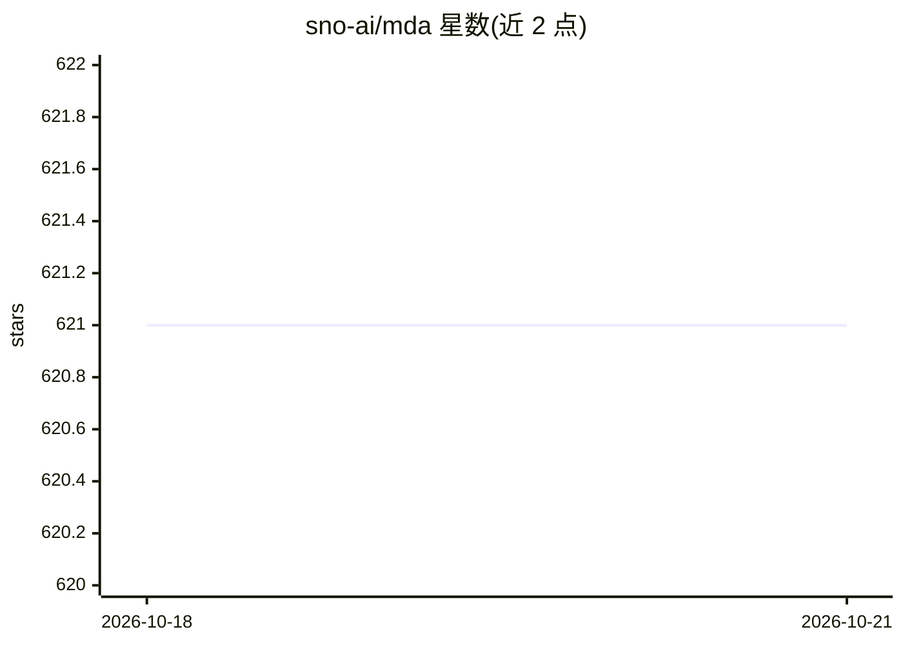

# sno-ai/mda

⭐ 621 · TypeScript · Apache-2.0 · 推送 2026-05-26 · [GitHub](https://github.com/sno-ai/mda) · [官网](https://mda.sno.dev) · 个人维护 · 中文 README

**给 agent 文档作者：一份 .mda 源编译为多运行时可加载的 .md 工件**

MDA 是一个开放规范加 TypeScript 参考实现（npm 包 @markdown-ai/cli）：定义一个 Markdown 超集 .mda 源，经确定性编译管线产出 SKILL.md、AGENTS.md、MCP-SERVER.md、CLAUDE.md 等目标文件，避免同一技能在多个 agent 运行时重复维护漂移。扩展点包括丰富 YAML frontmatter（doc-id、version、depends-on、requires）、带类型的脚注关系（parent/cites/supports 等），以及 JCS 规范化完整性摘要和 DSSE/Sigstore 签名。工件经 JSON Schema 2020-12 验证与一致性测试套件校验。v1.0 冻结契约本身；签名验证器、依赖解析器、注册中心与图索引器尚未交付，也不覆盖 Cursor MDC、Windsurf rules 等格式。

## 筛选速览

| 维度 | 判定 | 备注 |
|---|---|---|
| AI 角色 | `ai-ecosystem` | LLM/agent 周边工具 |
| 许可风险 | `permissive` | Apache-2.0 |
| 部署形态 | `None` |  |
| 模型依赖 | — | README 未给出锁定关系 |
| 硬件要求 | — | 无带数字的原话,不猜 |
| 安装摩擦 | `low` | 无编译、无系统依赖或容器化 |
| 成熟度 | `idea` | |

## 能力要点

- 一个 .mda 源确定性编译为 SKILL.md/AGENTS.md/MCP-SERVER.md/CLAUDE.md
- frontmatter 携带 JCS 完整性摘要与 Sigstore 锚定的 DSSE 签名
- 带类型脚注关系（parent/cites/supports/contradicts 等）编译时镜像到 metadata
- JSON Schema 2020-12 校验与一致性测试套件，支持 agent/人工/编译三种创作模式

## 适用场景

- 把同一技能源维护成多运行时可加载的指令文件
- 在 CI 或 agent 编辑前对工件做验证与完整性检查
- 为 agent 技能库声明依赖、版本锁定与文档间关系

## 场景标签

 · 领域:AI agent 工具链/文档规范

## 证据(README 行号)

> L16: You write one `.mda`. The compiler emits the rest.
> L116: Use the CLI as an authoring, CI, and agent-side checking tool, not as an application runtime dependency. The clean

## 星数曲线

2026-10-18 621 → 2026-10-21 621（+0）

---
*卡片 v1 · prompt 1.4 · 生成 2026-10-22 · 置信度 high · 依据 README sha `3a317188edc8` · [字段定义](../../DATASET.md)*
