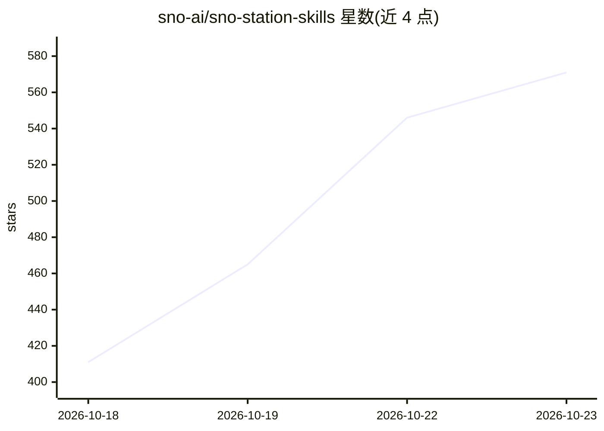

# sno-ai/sno-station-skills

⭐ 571 · Shell · Apache-2.0 · 推送 2026-10-20 · [GitHub](https://github.com/sno-ai/sno-station-skills) · [官网](https://sno.ai) · 组织维护

**给 Claude Code 与 Codex 安装31个协作技能，组成跨厂商开发团队**

向 Claude Code、Codex 等 agent CLI 安装 31 个技能（22 个安装单元），为编码 agent 提供工程团队的协作习惯：跨厂商 peer review、配额不足时自动交接（handoff/rotate-agent）、带验证记录的工作单、晨间简报、以及每夜读取当日会话并提出改进规则的回顾循环（需用户 accept 才生效）。通过 shell 一键安装脚本部署，另支持 OpenClaw 与 Hermes Agent。技能在发布前经自测。

## 筛选速览

| 维度 | 判定 | 备注 |
|---|---|---|
| AI 角色 | `ai-ecosystem` | LLM/agent 周边工具 |
| 许可风险 | `permissive` | Apache-2.0 |
| 部署形态 | `None` |  |
| 模型依赖 | — | README 未给出锁定关系 |
| 硬件要求 | — | 无带数字的原话,不猜 |
| 安装摩擦 | `low` | 无编译、无系统依赖或容器化 |
| 成熟度 | — | 结构信号不足 |

## 能力要点

- 31 个技能、22 个单元，覆盖审查/交接/报告/委派/回顾六类
- 跨厂商 peer review：在另一厂商 CLI 的新会话中审查代码
- 配额阈值触发的跨 agent 任务交接（heartbeat/rotate-agent/handoff）
- 每夜回顾循环从会话中提炼规则，经用户确认后生效

## 适用场景

- 让 Claude Code 与 Codex 互相审查代码改动
- 长任务过夜时在配额耗尽前自动换另一个 agent 接续
- 为 agent 任务生成带验证记录的工作单与晨间简报

## 场景标签

 · 领域:开发者工具/AI agent 基础设施

## 证据(README 行号)

> L16: **Sno Station Skills fixes the team, not the model.** These are the skills
> L23: **Dual Brain: different roles, one team.** One agent carries out your task. The other reviews
> L48: Or do it yourself with one command. It installs the `sno` command and sets up Sno Station, which puts

## 星数曲线

2026-10-18 411 → 2026-10-23 571（+160）

---
*卡片 v1 · prompt 1.4 · 生成 2026-10-21 · 置信度 high · 依据 README sha `8e3701bea418` · [字段定义](../../DATASET.md)*
