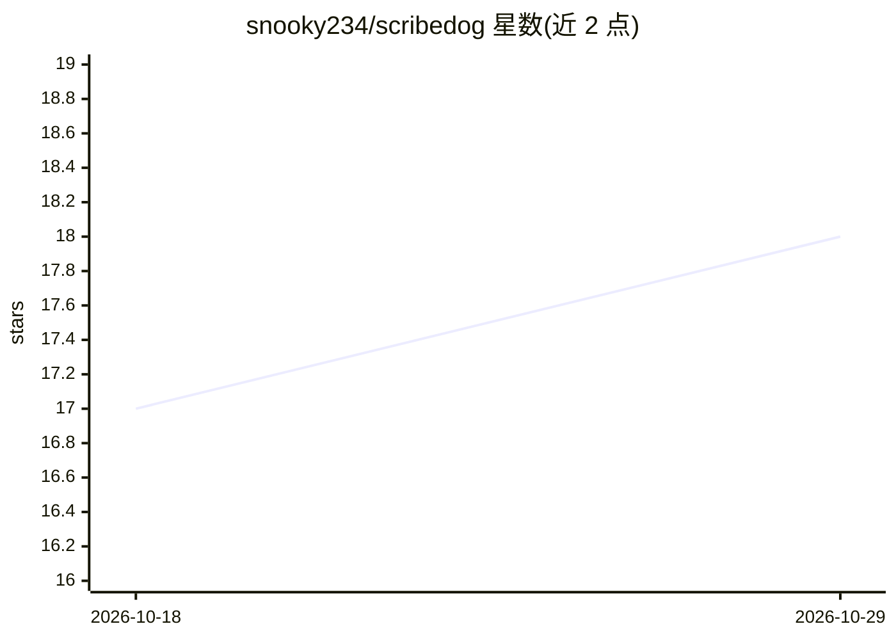

# snooky234/scribedog

⭐ 18 · TypeScript · MIT · 推送 2026-10-23 · [GitHub](https://github.com/snooky234/scribedog) · [官网](https://sourceforge.net/projects/scribedog/) · 个人维护

**本地优先的私有 Markdown 笔记编辑器，AI 可选本地运行**

面向笔记与写作用户的所见即所得编辑器，文件落盘为纯 Markdown，无数据库与专有格式。AI 为可选功能：接入本地模型运行器或云厂商 API，支持改写、插入、跨文件的 agentic 聊天（编辑经红绿审阅后确认）、基于自有笔记的知识库问答与离线语音听写（whisper.cpp 本地识别）。提供 Windows/Linux 桌面安装包与可自托管的 Server Edition（Docker/树莓派/NAS），支持多用户共享 vault 与编辑合并。无遥测，云 AI 自带 key。

## 筛选速览

| 维度 | 判定 | 备注 |
|---|---|---|
| AI 角色 | `ai-enhanced` | 去掉 AI 部分产品仍成立 |
| 许可风险 | `permissive` | MIT |
| 部署形态 | `desktop` | 安装包/桌面程序 |
| 模型依赖 | local-ok | 支持本地模型 |
| 硬件要求 | — | 无带数字的原话,不猜 |
| 安装摩擦 | `low` | 无编译、无系统依赖或容器化 |
| 成熟度 | — | 结构信号不足 |

## 能力要点

- 纯 Markdown 文件存储，支持双链/反向链接与版本历史快照
- AI 改写、agentic 聊天可跨文件提案编辑并批量撤销
- 基于自有笔记的知识库问答，回答附带来源笔记列表
- whisper.cpp 本地语音听写，音频不离设备
- 自托管 Server Edition 支持共享 vault 与冲突合并

## 适用场景

- 在不联网、不注册账号的前提下管理私有笔记库并用 AI 改写润色
- 自托管在 NAS 或树莓派上，从手机/浏览器访问并共享家庭笔记
- 让 AI 基于我自己的全部笔记回答问题并给出出处
- 通过语音口述离线输入笔记内容

## 场景标签

`知识库管理` `文档问答` `AI 写作` `语音识别` · 领域:内容生成

## 证据(README 行号)

> L19: choose, so they stay yours and open in any other tool. Optional AI helps you
> L132: ## 🤖 AI, local by default
> L295: AI is optional. To use a local model, install one model runner

## 星数曲线

2026-10-18 17 → 2026-10-29 18（+1）

---
*卡片 v1 · prompt 1.4 · 生成 2026-10-29 · 置信度 high · 依据 README sha `1bbc7e74190f` · [字段定义](../../DATASET.md)*
