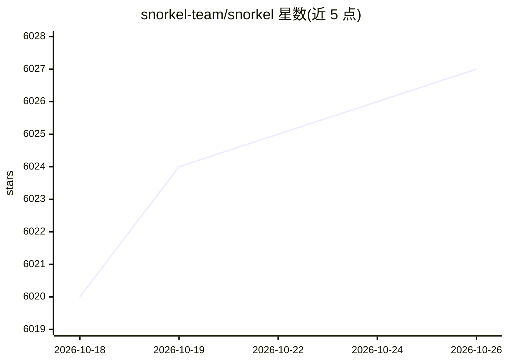

# snorkel-team/snorkel

⭐ 6,027 · Python · Apache-2.0 · 推送 2026-10-13 · [GitHub](https://github.com/snorkel-team/snorkel) · [官网](https://snorkel.org) · 组织维护

**弱监督编程式构建训练数据的 Python 框架**

起源于斯坦福（2015）的 Python 库，用于以编程方式标注、构建和管理机器学习训练数据：用户编写标注函数并通过弱监督建模、数据增强、数据切片等机制生成训练集，覆盖标注到模型开发管线。提供教程与文档，支持 pip 与 conda 安装，要求 Python 3.11+。README 声明团队已将精力转向商业平台 Snorkel Flow，本开源库为其前身与核心思想的实现。

## 筛选速览

| 维度 | 判定 | 备注 |
|---|---|---|
| AI 角色 | `ai-ecosystem` | LLM/agent 周边工具 |
| 许可风险 | `permissive` | Apache-2.0 |
| 部署形态 | `library` | 以包/库形式分发 |
| 模型依赖 | — | README 未给出锁定关系 |
| 硬件要求 | — | 无带数字的原话,不猜 |
| 安装摩擦 | `low` | 无编译、无系统依赖或容器化 |
| 成熟度 | — | 结构信号不足 |

## 能力要点

- 以编程方式标注、构建与管理训练数据
- 弱监督建模、数据增强、多任务学习、数据切片等机制
- 提供教程仓库与社区论坛，支持 pip/conda 安装

## 适用场景

- 为缺乏标注数据的 ML 任务编程式生成训练标签
- 研究弱监督与数据增强方法
- 作为模板学习标注技术并应用到自有数据

## 场景标签

`MLOps` · 领域:训练与推理

## 证据(README 行号)

> L8: ***Programmatically Build and Manage Training Data***
> L14: The Snorkel project started at Stanford in 2015 with a simple technical bet: that it would increasingly be the **tr
> L16: To say that the Snorkel project succeeded and expanded beyond what we had ever expected would be an understatement.

## 星数曲线

2026-10-18 6,020 → 2026-10-26 6,027（+7）

---
*卡片 v1 · prompt 1.4 · 生成 2026-10-20 · 置信度 high · 依据 README sha `4adb0cf9c848` · [字段定义](../../DATASET.md)*
