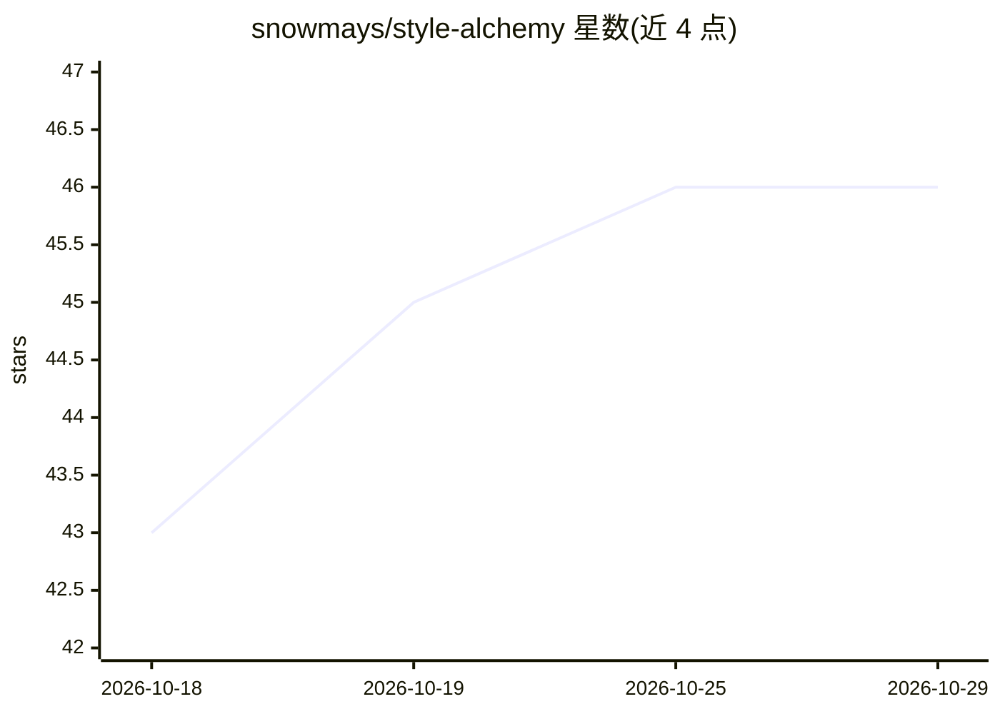

# snowmays/style-alchemy

⭐ 46 · Python · MIT · 推送 2026-05-15 · [GitHub](https://github.com/snowmays/style-alchemy) · 个人维护 · 中文 README

**把文章样本炼成风格档案并生成专属写作 skill 的 Claude Code 技能**

一个 Claude Code skill：读取 5-15+ 篇 .md/.txt/.html 文章样本，按 9 步工作流拆解写作风格（通用 5 维：标题/开篇/节奏/语言/结尾，外加公众号、知乎、小红书等场景增量维度），输出人类可读的分析报告、机器可读的 style_profile.yaml，并可一键生成 write-as-<id> 专属写作 skill。面向内容创作者、自媒体团队、法律/学术写作者、品牌方与 Agent 开发者。安装方式为 git clone 到 Claude Code 的 skills 目录。README 提示生成内容商用或涉真人/品牌时需自行评估合规风险。

## 筛选速览

| 维度 | 判定 | 备注 |
|---|---|---|
| AI 角色 | `ai-ecosystem` | LLM/agent 周边工具 |
| 许可风险 | `permissive` | MIT |
| 部署形态 | `None` |  |
| 模型依赖 | locked-api |  |
| 硬件要求 | — | 无带数字的原话,不猜 |
| 安装摩擦 | `low` | 无编译、无系统依赖或容器化 |
| 成熟度 | — | 结构信号不足 |

## 能力要点

- 输入 .md/.txt/.html 样本，输出分析报告、style_profile.yaml 与 write-as-<id> skill
- 通用 5 维 + 按平台启用的场景增量维度分析框架
- yaml 档案人工可编辑、可融合、可评估（后两项为 roadmap）
- 通过自然语言对话在 Claude Code 中启动，按 9 步工作流执行

## 适用场景

- 研究某作者或标杆账号的写作特征，沉淀成可复用的风格档案
- 把团队的品牌语气规范编译成可直接调用的写作 skill
- 对比同一人在不同平台的文体差异（分别建档）

## 场景标签

`AI 写作` `提示工程` · 领域:Agent 开发

## 证据(README 行号)

> L13: > **写作风格炼金术（Style Alchemy）是一个 Claude Code skill** —— 把一批文章样本自动炼化成可复用的写作风格档案，并生成一个按该风格写作的专属 Claude skill。
> L27:   3. write-as-<id> Claude skill 一键生成的专属写作助手（可选）

## 星数曲线

2026-10-18 43 → 2026-10-29 46（+3）

---
*卡片 v1 · prompt 1.4 · 生成 2026-10-25 · 置信度 high · 依据 README sha `65fa87dabf34` · [字段定义](../../DATASET.md)*
