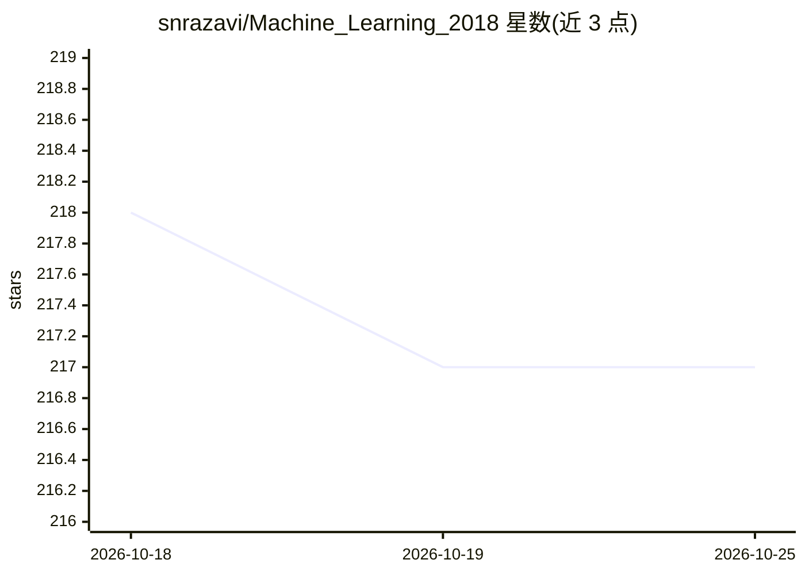

# snrazavi/Machine_Learning_2018

⭐ 217 · Jupyter Notebook · 推送 2026-01-26 · [GitHub](https://github.com/snrazavi/Machine_Learning_2018) · 组织维护

**机器学习课程代码与讲义仓库：波斯语教学配套练习**

伊朗大不里士大学 2018 秋季机器学习课程的代码与作业仓库，按章节组织内容：监督学习（线性/多项式回归、逻辑回归、正则化、神经网络与反向传播、SVM）与无监督学习（K-Means 聚类、PCA、异常检测、推荐系统）。各章节配套波斯语 PDF 幻灯片、波斯语 YouTube 讲解视频及延伸阅读书目（ESL、Goodfellow 深度学习等），并附 7 组编程作业。实现语言为 Python（含 NumPy、matplotlib）。

## 筛选速览

| 维度 | 判定 | 备注 |
|---|---|---|
| AI 角色 | `ai-knowledge` | 知识聚合/清单类 |
| 许可风险 | `none` | — |
| 部署形态 | `None` |  |
| 模型依赖 | — | README 未给出锁定关系 |
| 硬件要求 | — | 无带数字的原话,不猜 |
| 安装摩擦 | `low` | 无编译、无系统依赖或容器化 |
| 成熟度 | — | 结构信号不足 |

## 能力要点

- 覆盖回归、分类、神经网络、SVM、聚类、PCA、异常检测、推荐系统的章节代码
- 每章配套波斯语幻灯片（PDF）与 YouTube 视频讲解
- 含 7 组编程作业（作业 5 编号重复出现两次）
- 以 Python/NumPy 实现，含 PCA 与协同过滤示例

## 适用场景

- 跟随课程系统学习经典机器学习算法的推导与实现
- 查找线性回归、神经网络反向传播等算法的 Python 参考实现
- 获取波斯语机器学习教学幻灯片与视频资源

## 场景标签

`教程课程` · 领域:学习与行业

## 证据(README 行号)

> L1: # Machine Learning Course (Fall 2018)
> L2: Codes and Projects for Machine Learning Course, University of Tabriz.

## 星数曲线

2026-10-18 218 → 2026-10-25 217（-1）

---
*卡片 v1 · prompt 1.4 · 生成 2026-10-22 · 置信度 mid · 依据 README sha `30e5a89fc4ef` · [字段定义](../../DATASET.md)*
