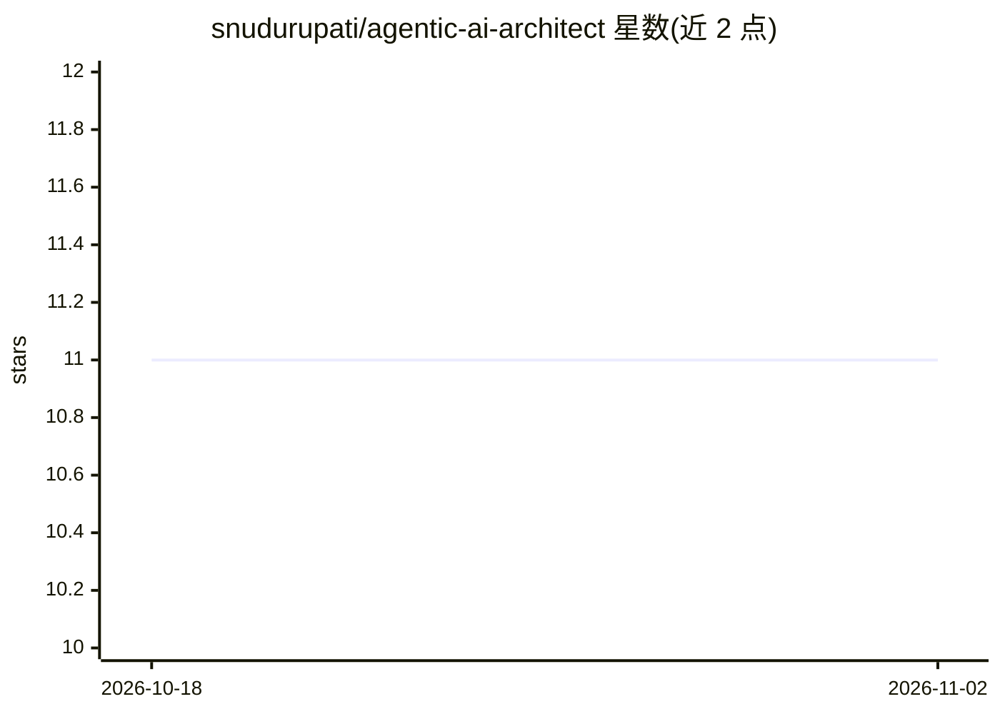

# snudurupati/agentic-ai-architect

⭐ 11 · Jupyter Notebook · MIT · 推送 2026-03-02 · [GitHub](https://github.com/snudurupati/agentic-ai-architect) · [官网](https://nudurupati.co/) · 个人维护

**数据工程师转型 AI 架构师的 8 周开源课程与代码**

仓库提供 8 周制课程路线图与配套代码，目标读者为数据工程师，主题从 LLM 基础（延迟与 token、Pydantic 结构化输出）递进到 RAG 基础与进阶（向量库、混合检索、重排）、LangGraph agent 编排、GraphRAG 多跳推理、持续预训练微调，最终以 CPT 与 GraphRAG 对比收尾，并构建一个生产可用的 Data Contract Validator agent。各周对应独立文件夹，通过 git clone 获取。

## 筛选速览

| 维度 | 判定 | 备注 |
|---|---|---|
| AI 角色 | `ai-knowledge` | 知识聚合/清单类 |
| 许可风险 | `permissive` | MIT |
| 部署形态 | `None` |  |
| 模型依赖 | — | README 未给出锁定关系 |
| 硬件要求 | — | 无带数字的原话,不猜 |
| 安装摩擦 | `low` | 无编译、无系统依赖或容器化 |
| 成熟度 | — | 结构信号不足 |

## 能力要点

- 8 周课程结构，每周对应一个代码文件夹
- 覆盖结构化输出、RAG、LangGraph 编排、GraphRAG、CPT 微调
- 以 Data Contract Validator agent 作为贯穿项目

## 适用场景

- 按周自学从 LLM 基础到 agent 架构的工程实践
- 数据工程师系统转型 AI 系统架构师
- 参考 CPT 与 GraphRAG 的对比实验设计

## 场景标签

`教程课程` · 领域:学习与行业

## 证据(README 行号)

> L5: This repository hosts the code and curriculum for the 8-week "Agentic AI Architect" roadmap. Each folder corresponds
> L11: |**Week&nbsp;0**|**The Agentic Data Engineer**|*The original demo. How to start thinking like an agent.*|

## 星数曲线

2026-10-18 11 → 2026-11-02 11（+0）

---
*卡片 v1 · prompt 1.4 · 生成 2026-11-01 · 置信度 high · 依据 README sha `28dc849b786e` · [字段定义](../../DATASET.md)*
