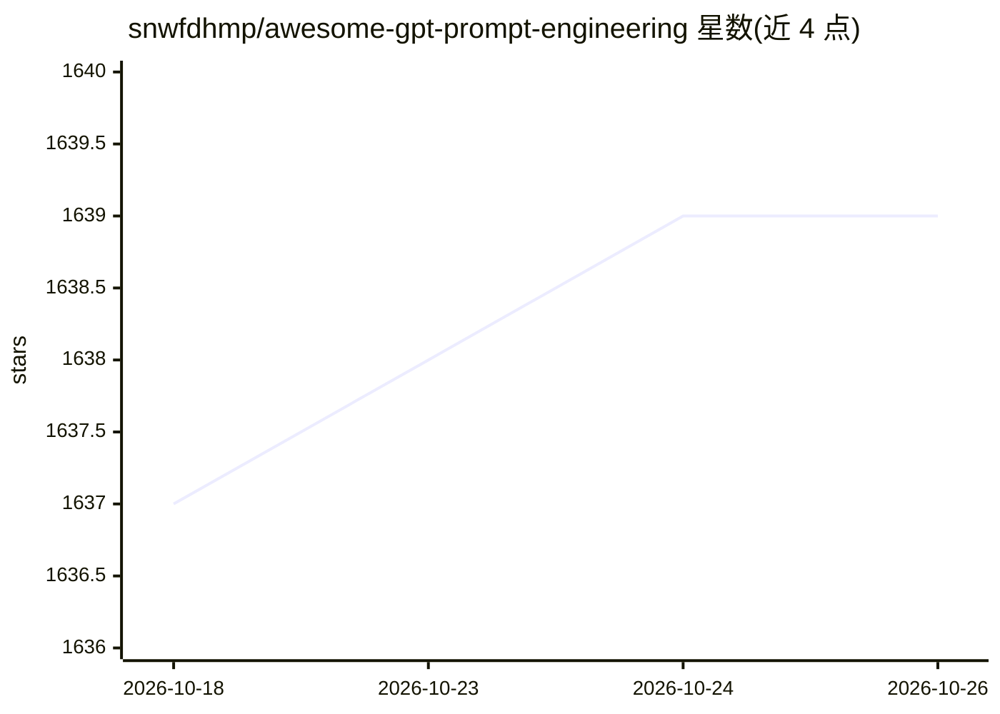

# snwfdhmp/awesome-gpt-prompt-engineering

⭐ 1,639 · Python · NOASSERTION · 推送 2026-02-23 · [GitHub](https://github.com/snwfdhmp/awesome-gpt-prompt-engineering) · 个人维护

**GPT 提示工程资源策展清单：指南/论文/工具/社区**

一个 awesome 清单类仓库，收录与 GPT 提示工程相关的资源：学习路线图与指南、提示技术（Few-Shot、Chain of Thought 等）、提示集合与市场、论文列表、书籍、社区、Playground 与替代 UI、提示生成器、Auto-GPT 相关项目、提示注入安全资料、ChatGPT 插件、招聘信息与 AI 目录。面向想学习或实践提示工程的开发者与终端用户，内容以条目罗列和简短描述为主，不提供代码运行。

## 筛选速览

| 维度 | 判定 | 备注 |
|---|---|---|
| AI 角色 | `ai-knowledge` | 知识聚合/清单类 |
| 许可风险 | `none` | NOASSERTION |
| 部署形态 | `None` |  |
| 模型依赖 | — | README 未给出锁定关系 |
| 硬件要求 | — | 无带数字的原话,不猜 |
| 安装摩擦 | `low` | 无编译、无系统依赖或容器化 |
| 成熟度 | — | 结构信号不足 |

## 能力要点

- 覆盖指南、技术、论文、书籍等多类提示工程资源
- 含 Chain of Thought、Tree of Thoughts 等提示技术条目
- 收录提示注入安全与 Auto-GPT 相关专题
- 包含 Playground、提示生成器与招聘等延伸分类

## 适用场景

- 系统学习提示工程的理论与技巧
- 查找提示集合、市场与提示优化工具
- 跟踪提示工程相关论文与技术进展

## 场景标签

`提示工程` `精选清单` · 领域:Agent 开发

## 证据(README 行号)

> L1: # Awesome GPT Prompt Engineering Awesome
> L3: A curated list of awesome resources, tools, and other shiny things for GPT prompt engineering.

## 星数曲线

2026-10-18 1,637 → 2026-10-26 1,639（+2）

---
*卡片 v1 · prompt 1.4 · 生成 2026-10-21 · 置信度 high · 依据 README sha `6ac205411e2d` · [字段定义](../../DATASET.md)*
