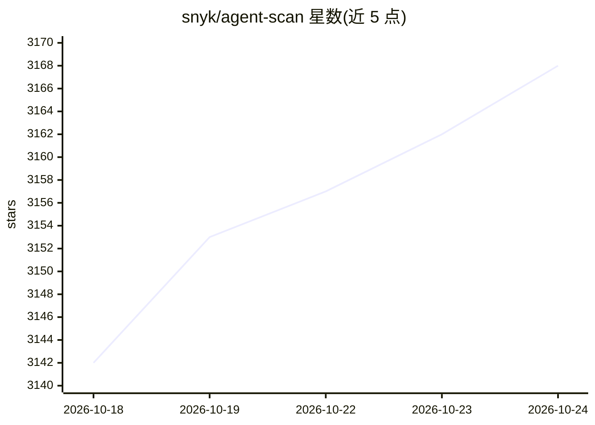

# snyk/agent-scan

⭐ 3,169 · Python · Apache-2.0 · 推送 2026-10-23 · [GitHub](https://github.com/snyk/agent-scan) · 组织维护

**扫描本机 AI agent 组件（MCP 服务器/技能）的安全检测 CLI**

Snyk 出品的命令行安全扫描器：自动发现本机安装的 agent 组件（harness、MCP 服务器、skills），检测提示注入、工具投毒、恶意代码载荷、硬编码密钥等 14-15 类风险。支持扫描 Claude Code/Desktop、Cursor、VS Code、GitHub Copilot、Windsurf、Gemini CLI、Codex 等 13 种 agent 的系统/用户/项目/插件四层配置。通过 uvx 运行 Python 包或下载带 GPG 签名校验的独立二进制，需 Snyk API token。注意：CLI 输出标记为实验性且 v0.5.x 计划弃用；扫描 MCP 配置会执行命令，官方建议在沙箱中运行。

## 筛选速览

| 维度 | 判定 | 备注 |
|---|---|---|
| AI 角色 | `ai-ecosystem` | LLM/agent 周边工具 |
| 许可风险 | `permissive` | Apache-2.0 |
| 部署形态 | `desktop` | 安装包/桌面程序 |
| 模型依赖 | — | README 未给出锁定关系 |
| 硬件要求 | — | 无带数字的原话,不猜 |
| 安装摩擦 | `low` | 无编译、无系统依赖或容器化 |
| 成熟度 | `idea` | |

## 能力要点

- 自动发现 13 种 agent 的 MCP 服务器与 skills 配置（四层作用域）
- 检测 14 类以上安全风险：提示注入、工具投毒、恶意载荷、密钥泄露等
- 独立二进制发布附带 SBOM 与 GPG 签名校验
- v0.6 起采用风险评分输出与 2026-07-10 分析 API

## 适用场景

- 盘点本机所有 AI agent 的 MCP 服务器与技能配置
- 在接入第三方 MCP 配置前检测提示注入与恶意载荷
- 企业环境统一核查各开发工具的 agent 组件安全风险

## 场景标签

`网络安全` · 领域:学习与行业

## 证据(README 行号)

> L37: Agent Scan helps you discover all your installed agent components (harnesses, MCP servers, and skills) and scans th
> L106: - Auto-discover MCP configurations, agent tools, skills
> L123: Agent Scan auto-discovers agents and their capabilities (MCP servers or skills) when their install paths exist. Th

## 星数曲线

2026-10-18 3,142 → 2026-10-24 3,168（+26）

---
*卡片 v1 · prompt 1.4 · 生成 2026-10-20 · 置信度 high · 依据 README sha `6f9f2f5eb1c9` · [字段定义](../../DATASET.md)*
