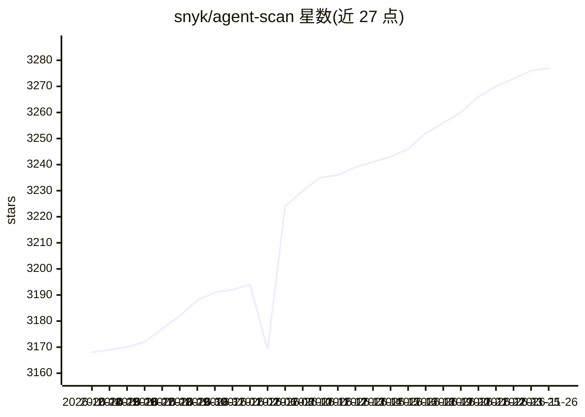

# snyk/agent-scan

⭐ 3,277 · Python · Apache-2.0 · 推送 2026-11-25 · [GitHub](https://github.com/snyk/agent-scan) · 组织维护

**扫描本机 AI agent、MCP 服务器与 skills 的安全检测 CLI**

Snyk 出品的命令行安全扫描器：自动发现本机安装的 agent 组件（harness、MCP 服务器、skills），检测 prompt injection、恶意载荷、凭据处理、硬编码密钥等安全风险，v0.6 起输出风险评分。扫描 MCP 配置时会执行命令或发起外连，需注意沙箱运行与同意提示；远程请求拒连 link-local 与云元数据地址。通过 uvx 运行 Python 包或下载独立二进制，需设置 SNYK_TOKEN；免费额度有每日使用限制，企业功能另需联系。

## 筛选速览

| 维度 | 判定 | 备注 |
|---|---|---|
| AI 角色 | `ai-ecosystem` | LLM/agent 周边工具 |
| 许可风险 | `permissive` | Apache-2.0 |
| 部署形态 | `desktop` | 安装包/桌面程序 |
| 模型依赖 | — | README 未给出锁定关系 |
| 硬件要求 | — | 无带数字的原话,不猜 |
| 安装摩擦 | `low` | 无编译、无系统依赖或容器化 |
| 成熟度 | `idea` | |

## 能力要点

- 自动发现 MCP 配置、agent 工具与 skills
- 覆盖 14-15 类安全风险检测（prompt injection、恶意代码、密钥等）
- 支持 Claude、Cursor、GitHub Copilot、Windsurf、Gemini CLI 等多 agent 扫描
- 发布物含 SBOM、GPG 签名校验的独立二进制

## 适用场景

- 安装第三方 MCP 服务器前检测 prompt injection 与恶意载荷
- 审计本机多个 agent（Claude Code、Cursor 等）的配置与 skills 安全
- 企业环境下批量发现机器上的 agent 组件风险

## 场景标签

`网络安全` · 领域:学习与行业

## 证据(README 行号)

> L3:  Discover and scan agent components on your machine for prompt injections
> L37: Agent Scan helps you discover all your installed agent components (harnesses, MCP servers, and skills) and scans th
> L131: Agent Scan auto-discovers agents and their capabilities (MCP servers or skills) when their install paths exist. Th

## 星数曲线

2026-10-24 3,168 → 2026-11-26 3,277（+109）

---
*卡片 v1 · prompt 1.4 · 生成 2026-11-23 · 置信度 high · 依据 README sha `7b7db0b65a71` · [字段定义](../../DATASET.md)*
