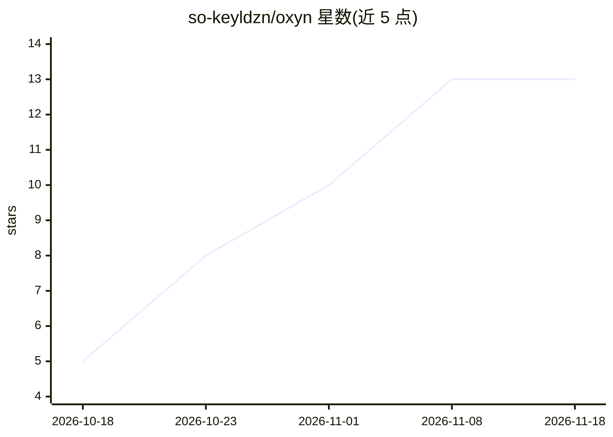

# so-keyldzn/oxyn

⭐ 13 · Rust · Apache-2.0 · 推送 2026-11-15 · [GitHub](https://github.com/so-keyldzn/oxyn) · [官网](https://oxyn.keyldzn.dev/) · 个人维护

**面向数据专业人士的本地数据库工作区，AI 辅助理解库表与查询**

基于 Tauri 2 与 Rust 内核的桌面数据库工作区，覆盖关系型、分析型、NoSQL、向量与图数据库的浏览、查询与管理；内置 PostgreSQL、MySQL/MariaDB、SQLite 协议驱动。定位是 AI agents 在用户旁边协助理解 schema 与查询，而非代为操作。面向数据专业人士。分发形式为 GitHub Releases 附带的签名 DMG（Apple Silicon macOS）与 DEB/RPM/AppImage（Linux），支持应用内更新；Windows 与 Intel macOS 不提供构建，其他平台需从源码用 make 构建。

## 筛选速览

| 维度 | 判定 | 备注 |
|---|---|---|
| AI 角色 | `ai-enhanced` | 去掉 AI 部分产品仍成立 |
| 许可风险 | `permissive` | Apache-2.0 |
| 部署形态 | `library` | 以包/库形式分发 |
| 模型依赖 | — | README 未给出锁定关系 |
| 硬件要求 | — | 无带数字的原话,不猜 |
| 安装摩擦 | `medium` | 含编译或系统依赖之一 |
| 成熟度 | — | 结构信号不足 |

## 能力要点

- Rust 内核与 Tauri 2 桌面应用，单一 Cargo workspace 组织
- 内置 PostgreSQL、MySQL/MariaDB、SQLite 协议驱动
- AI agents 以辅助方式帮助理解 schema 与查询（定位为 alongside，不代操作）
- 签名 macOS/Linux 构建并支持应用内更新

## 适用场景

- 浏览、检查表结构与行数据，执行 SQL 并查看结果
- 在 AI 辅助下理解数据库 schema 与查询
- 管理多种类型的数据库工作区

## 场景标签

`数据分析` · 领域:效率与自动化

## 证据(README 行号)

> L4: database — relational, analytical, NoSQL, vector, graph. AI agents help users
> L7: Intended audience: data professionals, people who read PostgreSQL error

## 星数曲线

2026-10-18 5 → 2026-11-18 13（+8）

---
*卡片 v1 · prompt 1.4 · 生成 2026-11-18 · 置信度 mid · 依据 README sha `6f65a63121e2` · [字段定义](../../DATASET.md)*
