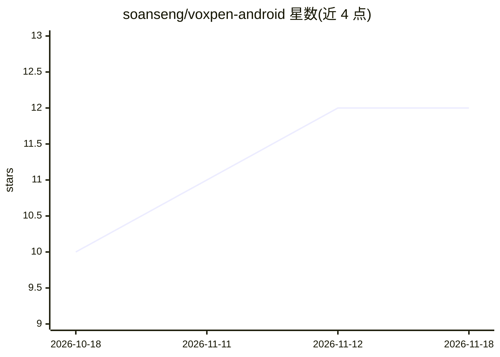

# soanseng/voxpen-android

⭐ 12 · Kotlin · Apache-2.0 · 推送 2026-09-10 · [GitHub](https://github.com/soanseng/voxpen-android) · [官网](https://voxpen.app) · 个人维护 · 中文 README

**Android AI 语音键盘：说出的话经 Whisper 转写、LLM 润色后插入任意应用**

开源 Android 输入法应用（Kotlin + Jetpack Compose，Min SDK 26）：点击麦克风后音频发送到 Whisper API 转写，可选经 LLM 润色，候选栏同时展示原始转写与润色版本，点击插入。BYOK 模式，用户自带 API key，音频直接从设备发往所选服务商。功能含翻译模式、选中文字后的语音改写、按当前应用自动切换文风、10 个免 API 调用的三语语音指令、音视频文件转写导出 TXT/SRT。支持繁体中文、英语、日语加自动检测。安装走 Releases APK 或源码构建（需 Android Studio/JDK 17）。

## 筛选速览

| 维度 | 判定 | 备注 |
|---|---|---|
| AI 角色 | `ai-native` | 本体是模型或模型工具 |
| 许可风险 | `permissive` | Apache-2.0 |
| 部署形态 | `None` |  |
| 模型依赖 | locked-api |  |
| 硬件要求 | — | 无带数字的原话,不猜 |
| 安装摩擦 | `medium` | 含编译或系统依赖之一 |
| 成熟度 | — | 结构信号不足 |

## 能力要点

- Whisper 转写 + LLM 润色的双版本候选栏
- BYOK：音频直连用户所选 API 服务商，无遥测、无账号
- 翻译模式与选中文字的语音改写（Edit Mode）
- 10 个三语本地语音指令，无需 API 调用

## 适用场景

- 在任意应用中用语音输入并自动润色成正式/随意文风
- 说中文即时输出英文等翻译文本
- 把音视频文件转写为字幕 SRT

## 场景标签

`语音识别` · 领域:感知与多模态

## 证据(README 行号)

> L30: VoxPen is an Android voice keyboard that transcribes your speech with Whisper, refines it with an LLM, and inserts 
> L88: |Provider|STT|LLM|Notes|

## 星数曲线

2026-10-18 10 → 2026-11-18 12（+2）

---
*卡片 v1 · prompt 1.4 · 生成 2026-11-18 · 置信度 high · 依据 README sha `9ef2d3901810` · [字段定义](../../DATASET.md)*
