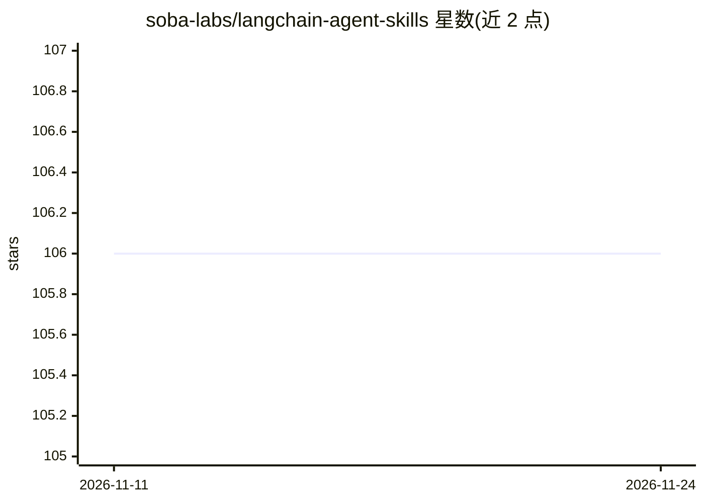

# soba-labs/langchain-agent-skills

⭐ 106 · Python · MIT · 推送 2026-11-11 · [GitHub](https://github.com/soba-labs/langchain-agent-skills) · [官网](https://sobalabs.ai/blog/langchain-agent-skills/) · 组织维护

**面向 AI 编程助手的 LangChain/LangGraph 技能包集合（9+1 个）**

由 Soba Labs 维护的 agent 技能仓库：提供 9 个生产级技能包加 1 个 skill-creator 元技能，覆盖 LangGraph 项目初始化、多 agent 协作模式、状态管理、错误处理、测试评测、LangSmith 追踪分析与生产部署，以及 Deep Agents 配置与任务规划。每个技能以 SKILL.md 为入口，附带可选脚本、参考与模板；格式与 Claude Code/Codex/OpenCode 兼容，可通过 npx skills CLI、Claude Code 插件市场、git clone 等方式安装到各编程助手。

## 筛选速览

| 维度 | 判定 | 备注 |
|---|---|---|
| AI 角色 | `ai-knowledge` | 知识聚合/清单类 |
| 许可风险 | `permissive` | MIT |
| 部署形态 | `library` | 以包/库形式分发 |
| 模型依赖 | — | README 未给出锁定关系 |
| 硬件要求 | — | 无带数字的原话,不猜 |
| 安装摩擦 | `low` | 无编译、无系统依赖或容器化 |
| 成熟度 | — | 结构信号不足 |

## 能力要点

- 9 个技能包覆盖 LangChain/LangGraph/LangSmith/Deep Agents 开发全周期
- SKILL.md 格式与 Claude Code、Codex、OpenCode、Cursor 兼容
- 支持 npx skills CLI 一键安装单个或全部技能
- 附带 skill-creator 元技能用于扩展技能集

## 适用场景

- 让 Claude Code/Codex/Cursor 等编程助手按最佳实践搭建 LangGraph 项目
- 调试与优化 LangGraph 多 agent 系统的状态管理与错误处理
- 用 LangSmith 追踪分析做生产部署前的性能排查
- 为 Deep Agents 项目配置子 agent、持久化与任务规划

## 场景标签

`Agent 框架` `多智能体` · 领域:Agent 开发

## 证据(README 行号)

> L7: A comprehensive collection of agent-optimized skills for AI coding assistants working in the LangChain ecosystem. Th
> L9: Each skill is a self-contained package with a `SKILL.md` entry point plus optional scripts, references, and template

## 星数曲线

2026-11-11 106 → 2026-11-24 106（+0）

---
*卡片 v1 · prompt 1.4 · 生成 2026-11-18 · 置信度 high · 依据 README sha `a4cc45a488f1` · [字段定义](../../DATASET.md)*
