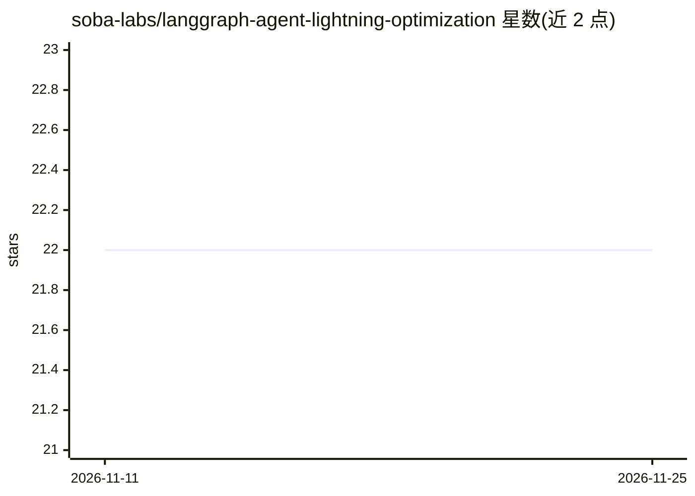

# soba-labs/langgraph-agent-lightning-optimization

⭐ 22 · MIT · 推送 2026-11-10 · [GitHub](https://github.com/soba-labs/langgraph-agent-lightning-optimization) · [官网](https://sobalabs.ai/blog/agent-lightning-langgraph-optimization/) · 组织维护

**LangGraph agent 提示词自动优化示例：APO 迭代训练**

Soba Labs 维护的示例工程，演示用 Agent Lightning 框架与 APO（Automatic Prompt Optimization）算法优化 LangGraph/OpenAI agent 的提示词：用 @rollout 装饰实现可追踪执行，LLM judge 按 0-1 打分，APO 用束搜索生成并测试提示词变体。以会议室排期（57 个测试用例）为示例任务。运行需 uv、Python 3.10+、OpenAI 与 AgentOps API key、额外安装 poml 包；官方支持 Linux，macOS 需 SharedMemory 修改且限制单 runner。

## 筛选速览

| 维度 | 判定 | 备注 |
|---|---|---|
| AI 角色 | `ai-ecosystem` | LLM/agent 周边工具 |
| 许可风险 | `permissive` | MIT |
| 部署形态 | `library` | 以包/库形式分发 |
| 模型依赖 | — | README 未给出锁定关系 |
| 硬件要求 | `cpu-ok` | |
| 安装摩擦 | `low` | 无编译、无系统依赖或容器化 |
| 成熟度 | — | 结构信号不足 |

## 能力要点

- APO 算法用束搜索迭代优化提示词
- LLM judge 对输出按 0-1 打分评估
- 同时提供 OpenAI 与 LangGraph 两种实现
- 优化后的提示词可配合更小模型使用

## 适用场景

- 学习如何对 LangGraph agent 做自动提示词优化
- 以会议室排期任务为模板复现 agent 训练流程
- 调试 agent 执行轨迹并分析基线表现

## 场景标签

`提示工程` · 领域:Agent 开发

## 证据(README 行号)

> L14: - Use APO algorithm to automatically improve prompts
> L16: - Work with both OpenAI and LangGraph implementations
> L125: APO will iteratively optimize the prompt template across multiple rounds, improving the agent's ability to correct

## 星数曲线

2026-11-11 22 → 2026-11-25 22（+0）

---
*卡片 v1 · prompt 1.4 · 生成 2026-11-18 · 置信度 mid · 依据 README sha `30abcce96c38` · [字段定义](../../DATASET.md)*
