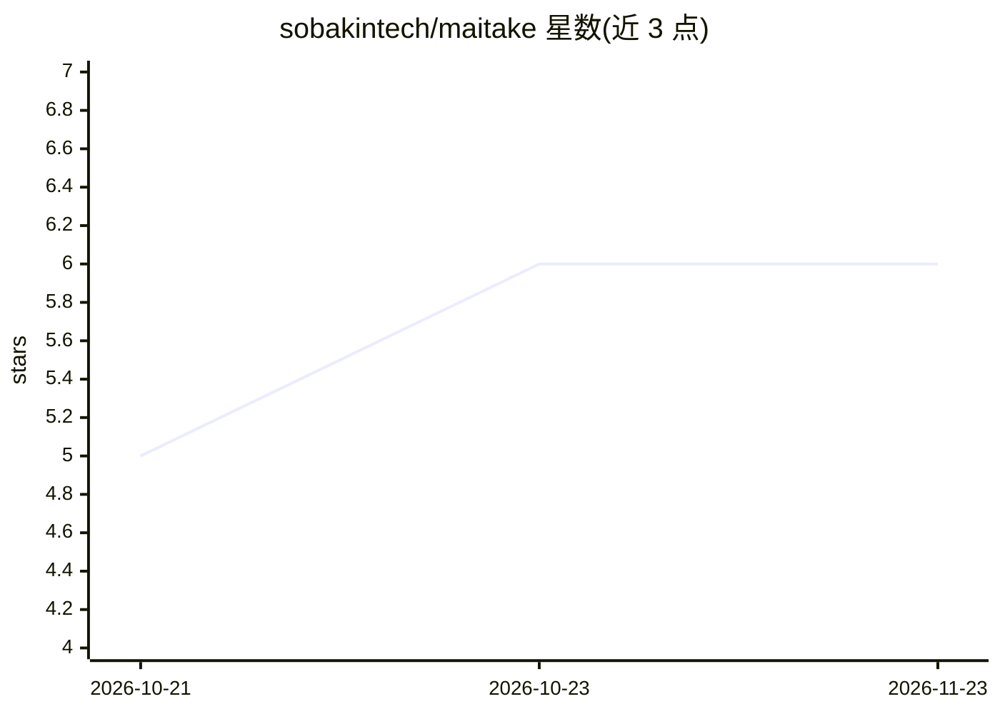

# sobakintech/maitake

⭐ 6 · Go · AGPL-3.0 · 推送 2026-11-08 · [GitHub](https://github.com/sobakintech/maitake) · 个人维护

**自托管网关：将 ChatGPT/Claude 订阅转为多用户共享的 API**

用 Go 编写的自托管多用户代理网关，将 ChatGPT 与 Claude 订阅账号转换为 Claude Messages、OpenAI Chat Completions 与 OpenAI Responses 三种兼容 API，并提供管理面板。关键机制包括每用户 API key（限定模型/限速/过期）、账号池（优先级、自动故障转移、冷却、令牌刷新）、实时配额跟踪与用量日志，配置存于 SQLite 且凭据加密。官方镜像仅覆盖 Claude 与 Codex 上游；使用订阅共享受服务商条款限制。

## 筛选速览

| 维度 | 判定 | 备注 |
|---|---|---|
| AI 角色 | `ai-ecosystem` | LLM/agent 周边工具 |
| 许可风险 | `viral` | AGPL-3.0 |
| 部署形态 | `self-host` | docker 或自建部署 |
| 模型依赖 | — | README 未给出锁定关系 |
| 硬件要求 | — | 无带数字的原话,不猜 |
| 安装摩擦 | `low` | 无编译、无系统依赖或容器化 |
| 成熟度 | — | 结构信号不足 |

## 能力要点

- 将订阅账号转为 OpenAI/Anthropic 兼容 API 端点
- 每用户 key、账号池自动故障转移与实时配额跟踪
- 内置管理面板与自助配额查询页
- 支持 Codex 图像生成端点与推理级别后缀

## 适用场景

- 团队多人共享订阅账号并按 key 分配配额
- 为现有 OpenAI 兼容客户端接入 Claude/Codex 订阅
- 通过面板集中管理账号池与用量审计

## 场景标签

`模型网关` · 领域:Agent 开发

## 证据(README 行号)

> L8: A multi-user proxy that serves AI subscriptions (ChatGPT, Claude and more) as Claude Messages, OpenAI Chat Completio
> L12: - Per-user API keys with allowed models, rate limits and expiry
> L13: - Account pool with priorities, automatic failover, cooldowns and token refresh

## 星数曲线

2026-10-21 5 → 2026-11-23 6（+1）

---
*卡片 v1 · prompt 1.4 · 生成 2026-11-21 · 置信度 mid · 依据 README sha `10986925ff42` · [字段定义](../../DATASET.md)*
