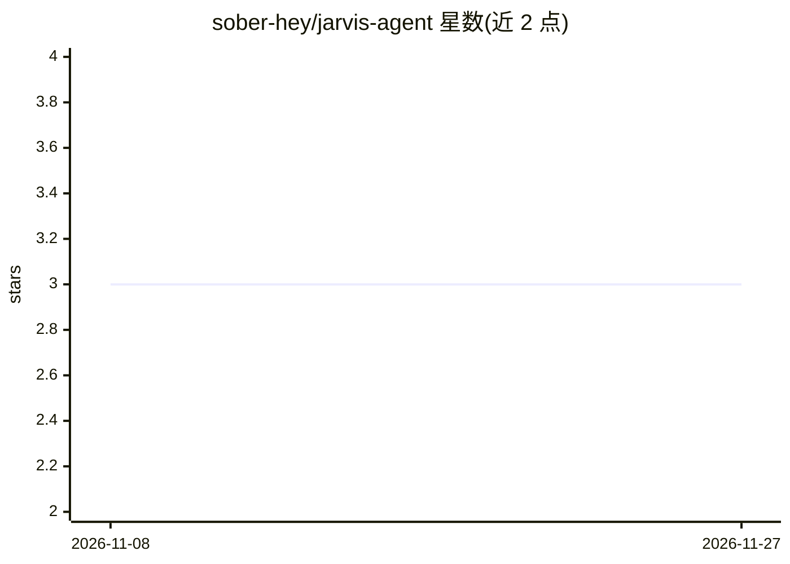

# sober-hey/jarvis-agent

⭐ 3 · Python · GPL-3.0 · 推送 2026-10-23 · [GitHub](https://github.com/sober-hey/jarvis-agent) · 个人维护 · 中文 README

**语音驱动的个人 AI 助理：长期记忆、自主作息，跑在 macOS 本机**

常驻个人电脑的语音智能体：语音为主入口，支持 Mac 菜单栏、iPhone、Apple Watch 接入；守护进程空闲时自主整理记忆与复盘。记忆采用 SQLite 只追加账本 + FTS5 检索 + 知识图谱投影；本地声纹模型区分主人与他人。模型思考委托给上游 Hermes Agent 引擎（需自行构建独立 venv）。当前仅 macOS 可日常自用，Linux 生产部署、回声消除、24 小时长跑等均未验收，单人设计、无多用户与账号体系。

## 筛选速览

| 维度 | 判定 | 备注 |
|---|---|---|
| AI 角色 | `ai-native` | 本体是模型或模型工具 |
| 许可风险 | `viral` | GPL-3.0 |
| 部署形态 | `None` |  |
| 模型依赖 | — | README 未给出锁定关系 |
| 硬件要求 | — | 无带数字的原话,不猜 |
| 安装摩擦 | `medium` | 含编译或系统依赖之一 |
| 成熟度 | `idea` | |

## 能力要点

- 语音进出：菜单栏/iPhone/Watch 三入口，流式语音回复
- SQLite 只追加账本 + FTS5 检索 + 知识图谱投影的长期记忆
- sherpa-onnx CAM++ 本地声纹，本人/他人判定与让路逻辑
- 语音合成用火山引擎 seed-tts-2.0，可切换百炼 CosyVoice

## 适用场景

- 在自己 Mac 上跑一个有长期记忆的语音助理
- 出门时通过 iPhone/Watch 与家中助理对话
- 内网环境下做本地优先的个人智能体二次开发

## 场景标签

`语音 Agent` `AI 助手` `Agent 记忆` · 领域:Agent 开发

## 证据(README 行号)

> L7: 一个常驻在自己电脑上的个人智能体：语音是主入口，长期记忆是底，模型负责思考与说话。
> L17: - **语音进出**：Mac 菜单栏、iPhone、Apple Watch 三个入口。说一句话，它接住、理解、回答，用流式语音回给你。
> L18: - **一个持续存在的大脑**：守护进程常驻，空闲时自己在想事、整理记忆、复盘；不是等你说一句才动一下。

## 星数曲线

2026-11-08 3 → 2026-11-27 3（+0）

---
*卡片 v1 · prompt 1.4 · 生成 2026-11-21 · 置信度 high · 依据 README sha `0f5f0a648201` · [字段定义](../../DATASET.md)*
