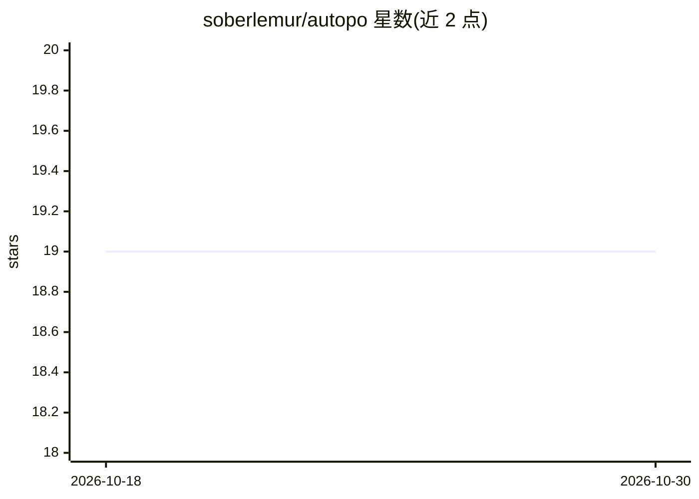

# soberlemur/autopo

⭐ 19 · Java · AGPL-3.0 · 推送 2026-10-26 · [GitHub](https://github.com/soberlemur/autopo) · [官网](https://autopo.ooo) · 个人维护

**用 AI 自动翻译 .po 本地化文件的桌面应用**

基于 Java 25 与 JavaFX 构建的桌面应用，读取 gettext 的 .po/.pot 文件，通过 LangChain4j 接入多种 AI 提供商自动生成翻译，用 Potentilla 库解析和写回 .po/.pot 文件，UI 主题采用 AtlantaFX。面向需要批量处理本地化文件的开发者与翻译人员，一键完成翻译。README 未列具体的模型提供商名单与运行环境细节，依赖 JDK。

## 筛选速览

| 维度 | 判定 | 备注 |
|---|---|---|
| AI 角色 | `ai-native` | 本体是模型或模型工具 |
| 许可风险 | `viral` | AGPL-3.0 |
| 部署形态 | `None` |  |
| 模型依赖 | — | README 未给出锁定关系 |
| 硬件要求 | — | 无带数字的原话,不猜 |
| 安装摩擦 | `medium` | 含编译或系统依赖之一 |
| 成熟度 | — | 结构信号不足 |

## 能力要点

- 读取并写回 .po/.pot 本地化文件
- 通过 LangChain4j 接入多种 AI 提供商
- JavaFX 桌面界面，一键完成批量翻译

## 适用场景

- 批量翻译项目的 gettext .po 本地化文件
- 软件发布前快速生成多语言翻译初稿

## 场景标签

`AI 写作` · 领域:内容生成

## 证据(README 行号)

> L7: Autopo is a desktop application that uses AI to automate `.po` file translations with speed and accuracy. High-quali
> L18: - **LangChain4j**: to interact with various AI providers.

## 星数曲线

2026-10-18 19 → 2026-10-30 19（+0）

---
*卡片 v1 · prompt 1.4 · 生成 2026-10-28 · 置信度 mid · 依据 README sha `fd6242d3c0e1` · [字段定义](../../DATASET.md)*
