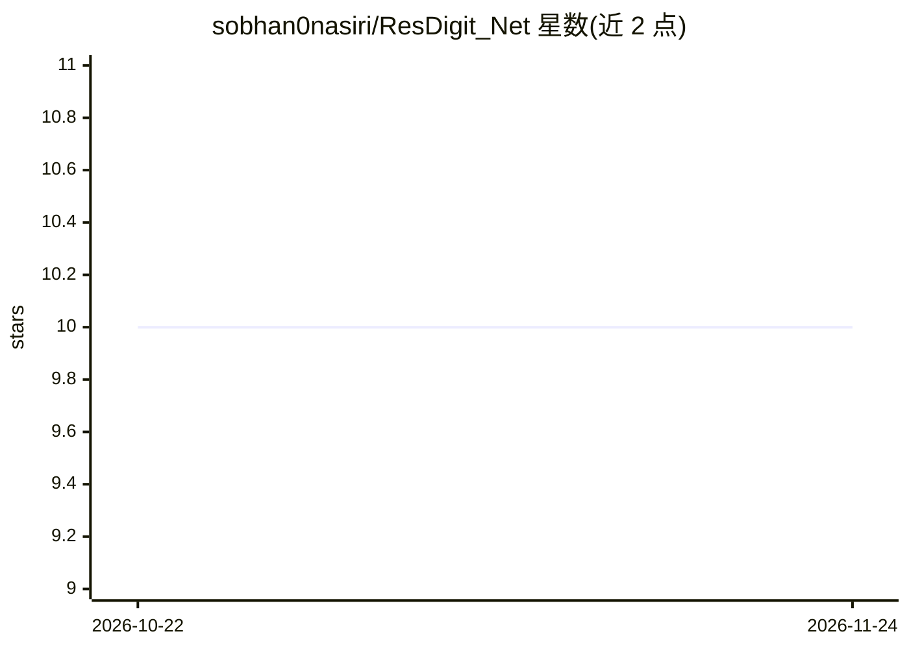

# sobhan0nasiri/ResDigit_Net

⭐ 10 · Python · 推送 2026-05-05 · [GitHub](https://github.com/sobhan0nasiri/ResDigit_Net) · 个人维护

**手写数字识别全栈系统：ResNet+ConvNeXt 混合模型与 FastAPI 后端**

基于 PyTorch 的手写数字识别全栈项目：模型采用 ResNet 残差学习与 ConvNeXt 设计哲学结合的混合架构（Depthwise 卷积、GELU、LayerNorm2d、7x7 大核），并附 Inference_Handler 类实现多模型 Soft Voting 集成推理。后端用 FastAPI/Uvicorn 提供 API，前端为 React 绘板，用户实时手写数字并获取预测。输入经 OpenCV 预处理流水线（质心居中、保持长宽比缩放至 28x28、噪声/模糊/膨胀数据增强）。MIT 许可，个人维护。

## 筛选速览

| 维度 | 判定 | 备注 |
|---|---|---|
| AI 角色 | `ai-native` | 本体是模型或模型工具 |
| 许可风险 | `none` | — |
| 部署形态 | `None` |  |
| 模型依赖 | — | README 未给出锁定关系 |
| 硬件要求 | — | 无带数字的原话,不猜 |
| 安装摩擦 | `low` | 无编译、无系统依赖或容器化 |
| 成熟度 | — | 结构信号不足 |

## 能力要点

- ResNet 残差学习与 ConvNeXt 设计结合的混合 CNN 架构
- Inference_Handler 类支持多模型 Soft Voting 集成推理
- OpenCV 预处理：质心居中、比例保持缩放、噪声数据增强
- FastAPI 后端 + React 实时手写绘板前端

## 适用场景

- 在网页绘板上实时手写数字并获取识别结果
- 作为计算机视觉实验的测试平台
- 学习混合 CNN 架构与集成推理的实现

## 场景标签

`目标检测` · 领域:感知与多模态

## 证据(README 行号)

> L23: **Hybrid-ModernCNN** is not just a classification model; it is a comprehensive testbed for Computer Vision experime
> L25: The core utilizes a **Modern Hybrid Architecture**, merging the residual learning of **ResNet** with the design phi
> L46: - **Ensemble-Ready:** Includes a dedicated `Inference_Handler` class capable of combining multiple models (Soft Vot

## 星数曲线

2026-10-22 10 → 2026-11-24 10（+0）

---
*卡片 v1 · prompt 1.4 · 生成 2026-11-19 · 置信度 high · 依据 README sha `8ee1435a190c` · [字段定义](../../DATASET.md)*
