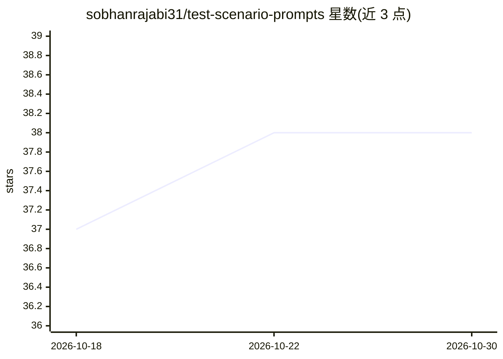

# sobhanrajabi31/test-scenario-prompts

⭐ 38 · MIT · 推送 2026-07-31 · [GitHub](https://github.com/sobhanrajabi31/test-scenario-prompts) · 个人维护

**用 AI 提示词从代码库生成手动测试场景文档**

一套提示词集合：将提示词放入任意能读写文件的 AI agent，指定目标源码路径后，agent 读取真实代码（函数、CSS 类、存储键、路由、错误字符串、常量），生成单文件 HTML 或 Markdown 手动测试场景文档。规则要求每行测试含可判定期望（精确字符串/数字/请求数/存储键）、稳定 ID，禁止编造代码中不存在的 API 或消息，歧义处转为'未定义行为需决策'测试。输出为独立 HTML 文件，双击打开、离线可用，含状态记录（localStorage）、进度条、搜索、过滤，无构建、无依赖。README 为波斯语/英语双语。

## 筛选速览

| 维度 | 判定 | 备注 |
|---|---|---|
| AI 角色 | `ai-knowledge` | 知识聚合/清单类 |
| 许可风险 | `permissive` | MIT |
| 部署形态 | `None` |  |
| 模型依赖 | — | README 未给出锁定关系 |
| 硬件要求 | — | 无带数字的原话,不猜 |
| 安装摩擦 | `low` | 无编译、无系统依赖或容器化 |
| 成熟度 | — | 结构信号不足 |

## 能力要点

- 期望值必须可判定，禁用'works correctly'类模糊表述
- 名称与路由直接取自真实代码，歧义转为'undefined behavior'测试而非编造
- 输出单文件 HTML：离线可用、状态存 localStorage、搜索/过滤/分区进度
- 覆盖清单含验证边界、离线、XSS、多标签并发、键盘可达性等类别

## 适用场景

- 把代码库交给 AI agent 生成可执行的手动测试场景清单
- 为 QA 团队生成带状态跟踪与稳定 ID 的测试文档用于回归
- 捕捉静默回归：错误提示合并、离线登出等不抛异常的缺陷

## 场景标签

`提示工程` · 领域:Agent 开发

## 证据(README 行号)

> L3: ### پرامپت ساخت سناریو های تست پروژه
> L7: فایل‌های سورس را می‌دهی، یک فایل HTML مستقل تحویل می‌گیری — صدها تست قابل‌قضاوت به صورت عمل و انتظار،

## 星数曲线

2026-10-18 37 → 2026-10-30 38（+1）

---
*卡片 v1 · prompt 1.4 · 生成 2026-10-25 · 置信度 high · 依据 README sha `ee8f9814c15a` · [字段定义](../../DATASET.md)*
