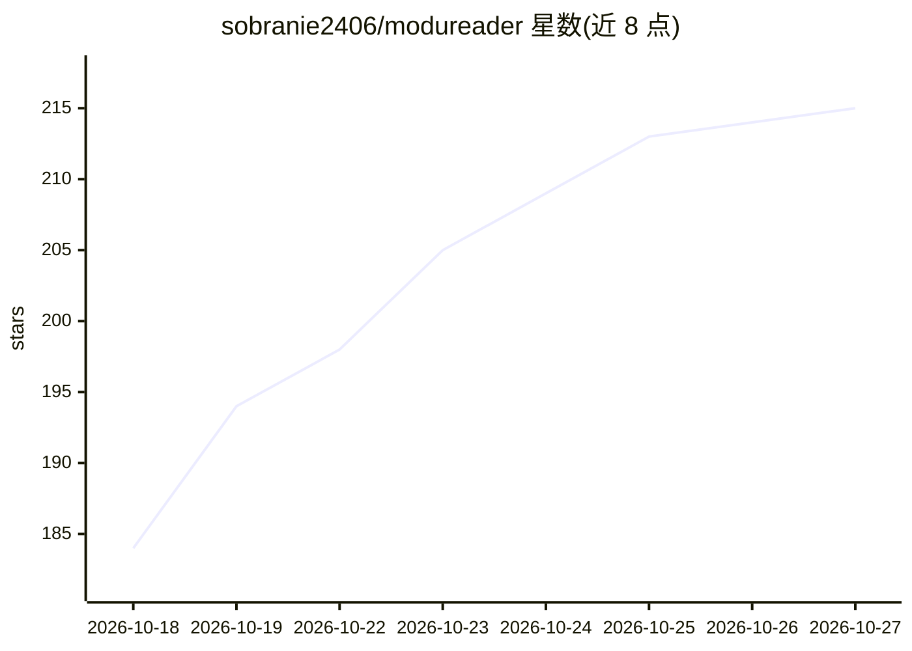

# sobranie2406/modureader

⭐ 215 · Dart · NOASSERTION · 推送 2026-10-26 · [GitHub](https://github.com/sobranie2406/modureader) · [官网](https://github.com/sobranie2406/modureader/releases/latest) · 个人维护 · 中文 README

**跨平台开源电子书/PDF 阅读器，含 OCR、AI 阅读与听书**

基于 Flutter 的跨平台阅读器，支持 EPUB、PDF、MOBI、TXT 等格式，覆盖 Windows/Linux/macOS/Android/iOS/鸿蒙。核心阅读功能之外，提供设备端 OCR（PP-OCR 系列轻量模型）、本地/远程向量索引与语义检索、多协议 AI 阅读问答（OpenAI 兼容、Claude、Gemini）、多引擎 TTS 听书与翻译；可通过 WebDAV 或 S3 兼容对象存储同步阅读数据。本地阅读不需要 AI 账号，AI 与在线服务按需配置。

## 筛选速览

| 维度 | 判定 | 备注 |
|---|---|---|
| AI 角色 | `ai-enhanced` | 去掉 AI 部分产品仍成立 |
| 许可风险 | `none` | NOASSERTION |
| 部署形态 | `None` |  |
| 模型依赖 | locked-api |  |
| 硬件要求 | — | 无带数字的原话,不猜 |
| 安装摩擦 | `low` | 无编译、无系统依赖或容器化 |
| 成熟度 | — | 结构信号不足 |

## 能力要点

- 设备端离线 OCR（PP-OCR 模型按需下载，无需 API Key）
- 书籍向量索引与语义检索（本地 ONNX 模型或远程嵌入 API）
- 多协议 AI 阅读问答、思维导图与划词自定义 AI 命令
- WebDAV / S3 兼容存储同步与数据库 ZIP 备份

## 适用场景

- 在手机和电脑上阅读电子书、PDF 与扫描图片书
- 对扫描书做文字重排、划词标注与原页对照
- 用 AI 做章节总结、概念解析并生成思维导图
- 多设备同步阅读进度、笔记与朗读位置

## 场景标签

`语音合成` `OCR` `文档问答` · 领域:内容生成

## 证据(README 行号)

> L7:  默读是基于 Flutter 的开源跨平台阅读器，支持电子书、PDF 与扫描图片书籍。裁边增强、设备端 OCR、分屏对照、翻译、听书与 AI 阅读，让不同格式的书籍更易阅读；可关联微信读书公开资料，通过 WebDAV 或 S3 兼容
> L38: > **本地阅读不需要 AI 账号。** AI、在线翻译和在线语音按需配置，费用与可用性取决于所选服务。各版本更新与使用说明见 Releases。
> L411: 2. 在书架添加电子书，打开后即可阅读；不使用 AI 时无需填写任何 API Key。

## 星数曲线

2026-10-18 184 → 2026-10-27 215（+31）

---
*卡片 v1 · prompt 1.4 · 生成 2026-10-22 · 置信度 high · 依据 README sha `c154b42091cd` · [字段定义](../../DATASET.md)*
