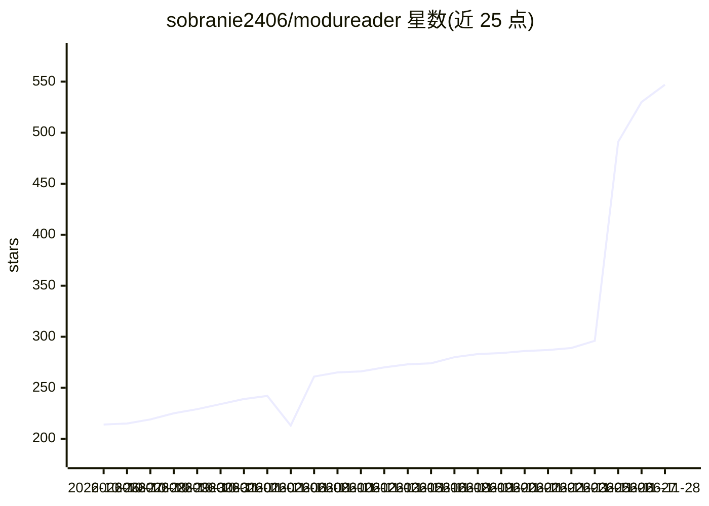

# sobranie2406/modureader

⭐ 547 · Dart · NOASSERTION · 推送 2026-11-26 · [GitHub](https://github.com/sobranie2406/modureader) · [官网](https://github.com/sobranie2406/modureader/releases/latest) · 个人维护 · 中文 README

**开源跨平台电子书/PDF 阅读器，带 AI 阅读与 OCR**

基于 Flutter 的开源阅读器，覆盖 Android、iOS、macOS、Windows、Linux 与原生鸿蒙六端。核心功能为多格式书库管理（EPUB/PDF/MOBI/AZW3 等 8 种格式、WebDAV 下载）、自由排版、竖排阅读、CSS 自定义样式、高亮笔记与阅读记录。AI 相关功能包括：设备端离线 OCR 重排扫描书、逐段翻译、多服务 TTS 听书（Edge TTS/OpenAI 兼容/DashScope/小米 MiMo）、接入自选 AI 服务的选文解释与章节总结，以及 WebDAV/S3 跨设备同步。本地阅读无需 AI 账号，在线功能按需选用。基于 Anx Reader 并包含 ReadAny 代码，GPL-3.0-or-later 发布。

## 筛选速览

| 维度 | 判定 | 备注 |
|---|---|---|
| AI 角色 | `ai-enhanced` | 去掉 AI 部分产品仍成立 |
| 许可风险 | `none` | NOASSERTION |
| 部署形态 | `None` |  |
| 模型依赖 | — | README 未给出锁定关系 |
| 硬件要求 | — | 无带数字的原话,不猜 |
| 安装摩擦 | `low` | 无编译、无系统依赖或容器化 |
| 成熟度 | — | 结构信号不足 |

## 能力要点

- 轻量 OCR 模型在设备端离线运行，扫描页转为可排版文字
- TTS 支持 Edge TTS、小米 MiMo、OpenAI 兼容服务与 DashScope
- AI 阅读可接入自有服务并自定义阅读技能
- 通过自建 WebDAV 或 S3 兼容存储同步书籍与笔记

## 适用场景

- 在多平台设备上管理 EPUB/PDF 等格式的个人书库
- 扫描版 PDF 离线 OCR 重排后阅读并标注
- 外文或文言书籍逐段翻译对照阅读
- 用自己的 AI 服务账号总结章节、解释选文

## 场景标签

`语音合成` `OCR` · 领域:内容生成

## 证据(README 行号)

> L7:  开源、跨平台的阅读器。整理书库，专注阅读，用标注、翻译、听书和 AI 读懂每一本书。
> L22: 支持 Android、iOS、macOS、Windows、Linux 与原生鸿蒙。本地阅读无需 AI 账号，在线功能按需选用。
> L100: 解释选文、总结章节、梳理论证、追踪人物，或生成思维导图。接入自己的 AI 服务，自定义阅读技能，围绕书中内容继续追问。

## 星数曲线

2026-10-26 214 → 2026-11-28 547（+333）

---
*卡片 v1 · prompt 1.4 · 生成 2026-11-27 · 置信度 high · 依据 README sha `289a6a19c608` · [字段定义](../../DATASET.md)*
